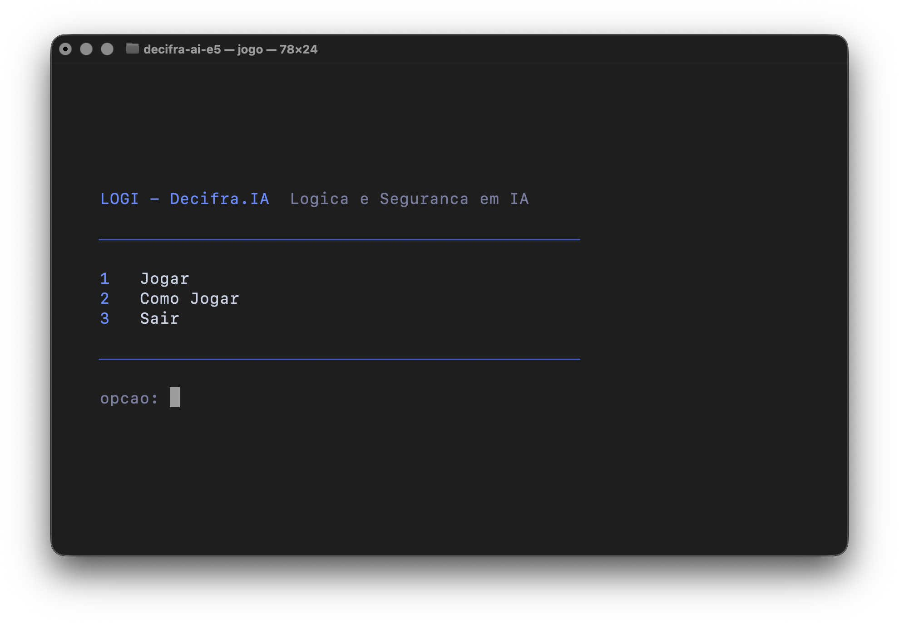
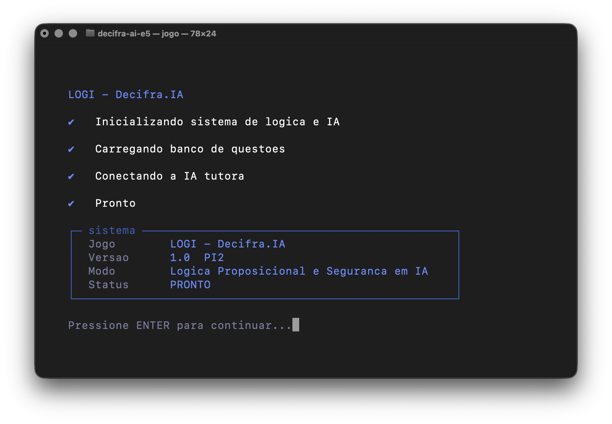
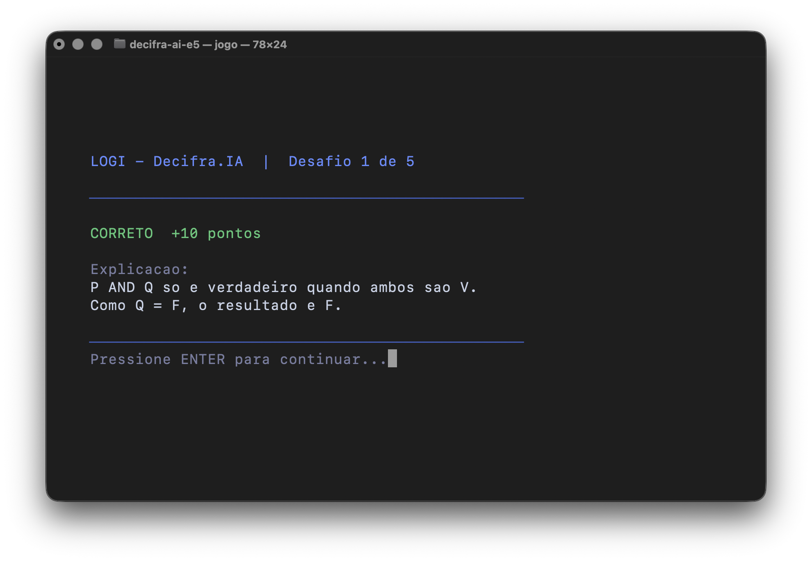
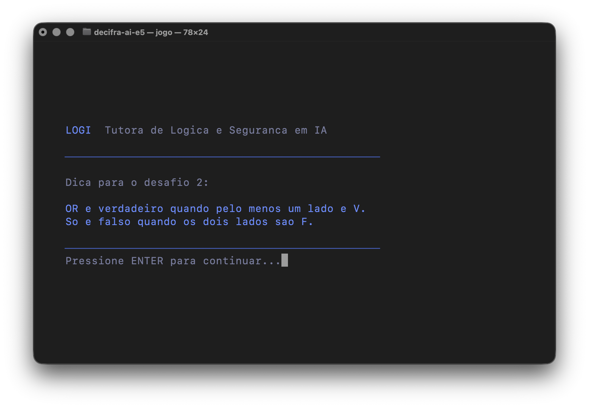
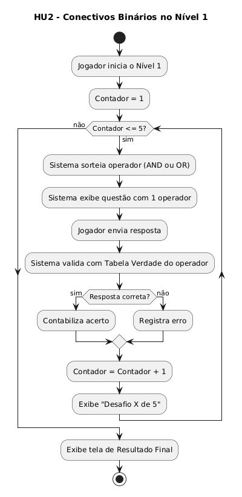
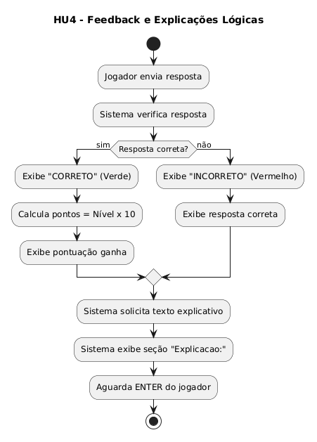
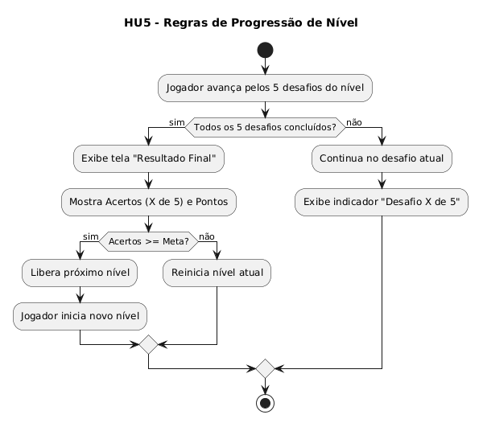
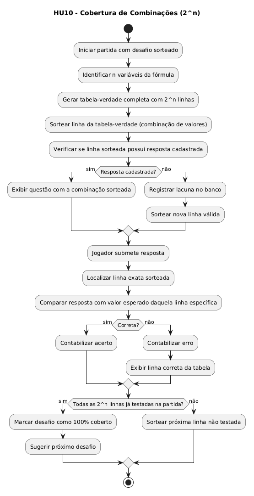

# LOGI - Decifra.IA


Jogo educacional de terminal que une lógica proposicional e conscientização sobre Inteligência Artificial.

Desenvolvido por Squad 05 como Projeto Integrador 2P - E5 no CESAR School.

Implementado em **C** na Unidade 1 e **Haskell** na Unidade 2.

---

## Sobre o Jogo

Você está em 2031. A IA já permeia tudo: contrata, diagnostica, julga, governa. A maioria das pessoas apenas aceita as respostas que ela dá.

Mas você conheceu a **LOGI**.

LOGI não é um chatbot qualquer. Ela é uma IA tutora criada para ensinar o que poucos ainda dominam: **pensar com rigor lógico**. Ela acredita que a melhor defesa contra uma IA opaca é um humano que sabe raciocinar.

A cada sessão, LOGI te apresenta desafios de lógica proposicional, os mesmos fundamentos matemáticos que estão por trás de qualquer sistema de IA. Ela explica operadores como AND, OR, NOT, IMPLICA e BICONDICIONAL não como curiosidades acadêmicas, mas como ferramentas de pensamento crítico para o mundo que vivemos.

Entre cada desafio, ela conta um pouco sobre como a IA funciona, onde ela erra, o que ela não consegue fazer sozinha, e por que você, humano, ainda importa.

**Decifre as proposições. Questione as máquinas. Pense por conta própria.**

---

## O que o jogo ensina

### Lógica Proposicional

| Operador | Regra |
|---|---|
| `AND` | verdadeiro apenas quando ambos os lados são V |
| `OR` | verdadeiro quando pelo menos um lado é V |
| `NOT` | inverte o valor lógico |
| `IMPLICA` | falso apenas quando P = V e Q = F |
| `BICONDICIONAL` | verdadeiro quando os dois lados têm o mesmo valor |

### Conscientização em IA

O jogo aborda de forma narrativa temas como:

- Viés algorítmico — quando a IA reflete os preconceitos dos dados com que foi treinada
- Opacidade de modelos — o problema da "caixa preta" e a dificuldade de auditar decisões automáticas
- Falsas certezas — por que alta acurácia em treino não garante segurança no mundo real
- Papel humano — o lugar do pensamento crítico e da responsabilidade em sistemas híbridos

---
## Fluxo do Jogo

```
Menu principal (7 opções)
├── 1. Jogar (nível básico)
│   ├── Loading -> Informe seu nome
│   ├── Desafios 1-5 (AND/OR/NOT/IMPLICA/BICONDICIONAL, 2 variáveis)
│   │   ├── [V]/[F] resposta | [H] pedir dica à LOGI
│   │   └── Feedback: acerto/erro + explicação + pontuação + moedas
│   └── Resultado final
├── 2. Como Jogar (regras e operadores)
├── 3. Exemplos de Escopo (casos didáticos)
├── 4. Nível Avançado
│   ├── Desafios 6-10 (expressões compostas, 3 variáveis, parênteses)
│   └── Mesmo fluxo V/F/H do nível básico
├── 5. Contra-Tempo
│   ├── Timer de 20s por desafio
│   └── Bônus +50% se responder em até 10s, +25% em até 15s
├── 6. Loja de Itens e Lootbox
│   ├── Comprar Dica (15 moedas) | Comprar Lootbox (30 moedas)
│   └── Animação e sorteio de prêmios aleatórios
└── 7. Sair
```

---

## Screenshots

**Menu principal**



**Tela de inicialização**



**Como Jogar**


**Feedback de resposta correta**



**Tutora LOGI — dica contextual**



---

## Funcionalidades da UI

- **Alternate screen buffer** — o jogo roda como uma CLI isolada, sem rolar o terminal
- **Posicionamento absoluto de cursor** — nenhuma tela causa scroll; todo conteúdo é impresso em coordenadas fixas via `\033[row;colH`
- **Fade-in simultâneo em tela cheia** — todas as linhas aparecem juntas com brilho crescente via ANSI true-color RGB
- **Spinner braille animado** (⠋⠙⠹⠸⠼⠴⠦⠧⠇⠏ → ✔) nas telas de loading e saída
- **Paleta azul** derivada da identidade visual LOGI (#12122A em variantes mais claras)
- **Respostas V/F** sem diferenciação de maiúsculas/minúsculas
- **Sinal SIGINT capturado** — Ctrl+C restaura o terminal corretamente

---

## Equipe

| Integrante | Frente |
|---|---|
| Guilherme Alves de Souza | Gestão Ágil + Engenharia de Software |
| Hilton Resende | Gestão Ágil |
| João Guilherme Azevedo | Gestão Ágil |
| João Bezerra | Engenharia de Software |
| João Antonio Calazans | Design de Interação (IHC) |
| Pedro Feitosa | Lógica Matemática (LMC) |
| Ademir Pedro da Silva Filho | Motor em C (PIF) |
| Arthur Vieira Neiva Souza | Haskell (PIF) |
| Augusto Freitas Wanderley | Engenharia de Software |

---

## Estrutura do Projeto

```
logi-decifra-ai/
│
├── .github/
│   └── workflows/
│       └── build.yml         # CI/CD: Compilação automática no GitHub Actions
│
├── assets/
│   └── audio/                # Recursos de áudio (US15)
│       ├── menu.mp3          # Trilha sonora do menu principal
│       ├── gameplay.mp3      # Trilha sonora durante os desafios
│       ├── win.mp3           # Efeito sonoro de acerto
│       └── lose.mp3          # Efeito sonoro de erro/timeout
│
├── docs/                     # Documentação técnica e acadêmica (PI2-98 / PI2-99)
│   ├── diagrams/             # Diagramas de atividades e arquitetura (PNG)
│   ├── screenshots/          # Evidências visuais (prints do terminal e Jira)
│   ├── arquitetura.md        # Documento de arquitetura do sistema
│   ├── casos_testes_logicos.md
│   ├── fundamentos_logica_proposicional.md
│   ├── plano_de_testes.md    # Plano de testes unitários e de sistema
│   ├── proposicoes-logicas.md
│   ├── relatorio-tecnico.md
│   ├── requisitos_relatorio.md # Documento de Requisitos (RF e RNF)
│   ├── tabelas_verdade_proposicoes_logicas.md
│   └── tabelas-verdade.md
│
├── include/                  # Arquivos de cabeçalho (.h) - Contratos das APIs
│   ├── ai_client.h           # Interface de comunicação com a LOGI
│   ├── audio.h               # Gerenciamento de áudio (US15)
│   ├── colors.h              # Definições de cores ANSI (RGB)
│   ├── game.h                # Structs, enums e protótipos do núcleo do jogo
│   ├── input.h               # Leitura de teclado em modo raw (sem Enter)
│   └── ui.h                  # Protótipos das telas e renderizações
│
├── scripts/                  # Scripts auxiliares (Integração Python/IA)
│   ├── ai_client.py          # Bridge Python para o modelo LLM (local → HuggingFace; não chamado pelo binário C)
│   ├── local_server.py       # Servidor local para testes da IA
│   ├── modal_server.py       # Deploy do modelo no Modal (Cloud)
│   └── requirements.txt      # Dependências Python
│
├── src/                      # Código-fonte em C (.c)
│   ├── main.c                # Ponto de entrada, loop principal e roteamento do menu
│   ├── game.c                # Parser lógico, geração de tabela-verdade, economia e regras
│   ├── ui.c                  # Renderização ANSI, animações (fade/loading/timer) e telas
│   ├── input.c               # Captura de inputs do usuário (V, F, H, N)
│   ├── ai_client.c           # Dicas determinísticas baseadas nos operadores do enunciado (AND/OR/NOT/IMPLICA/BICONDICIONAL)
│   └── audio.c               # Execução assíncrona de áudio (ffplay/system)
│
├── tests/                    # Testes de software
│
├── .gitignore                # Arquivos ignorados pelo Git (binários, objetos)
├── Makefile                  # Automação de build (make, make run, make clean)
└── README.md                 # Documentação principal do repositório
```

---

## Como compilar e rodar

### Pré-requisitos

- gcc
- make

### Instalação das dependências

**Ubuntu/Debian:**
```bash
sudo apt update
sudo apt install build-essential
```

**macOS:**
```bash
xcode-select --install
```

**Windows (recomendado usar WSL):**
```powershell
wsl --install
# Após reiniciar:
sudo apt update
sudo apt install build-essential
```

### Build e execução

```bash
make          # Compila
make run      # Compila e executa
make clean    # Limpa arquivos compilados
```

### Interface gráfica (raylib)

Além do jogo de terminal, existe uma versão com janela gráfica (PI2-189), com as mesmas regras, modos, loja e narração da LOGI:

```bash
make gui      # Compila ./jogo_gui
make run-gui  # Compila e executa
```

Requer a [raylib](https://www.raylib.com/) instalada (no Ubuntu: `sudo apt update && sudo apt install libraylib-dev`; se o pacote não existir na sua versão, compile a raylib pelo código-fonte conforme o site). No WSL, a janela abre via WSLg (Windows 10/11 atualizado). Use o teclado (V, F, H, P, T, 1-8, ENTER) ou clique nos botões. A fonte padrão da raylib não tem acentos, então os textos seguem sem acento.

---

## Roadmap

### Unidade 1 — concluído

- [x] Telas com navegação completa e alternate screen buffer
- [x] Animações fade-in simultâneo com ANSI true-color e spinner braille
- [x] Parser recursivo de descida para expressões lógicas (`eval_expr` / `eval_or` / `eval_and` / `eval_not` / `eval_impl` — `src/game.c`)
- [x] Geração dinâmica de desafios via RNG (`/dev/urandom`) com cobertura de 2^n combinações (HU10)
- [x] Banco de 10 desafios cobrindo AND, OR, NOT, IMPLICA, BICONDICIONAL e expressões com 3 variáveis (HU1–HU6)
- [x] Nível Avançado com expressões compostas e parênteses (opção 4 do menu, HU12)
- [x] Modo Contra-Tempo com bônus de velocidade e timer de 20s (opção 5 do menu, HU11)
- [x] Dica contextual inline da LOGI ao pressionar H (HU8)
- [x] Integração de dicas contextuais via `src/ai_client.c` — lógica determinística que identifica operadores (AND/OR/NOT/IMPLICA/BICONDICIONAL) no enunciado e retorna a regra correspondente; `scripts/ai_client.py` implementa bridge Python para o modelo Qwen2.5-1.5B no HuggingFace (disponível para integração futura) · [ver modelo no HuggingFace](https://huggingface.co/guiiwfz/logi-1.5b-gguf)
- [x] Persistência local do highscore em `~/.decifra_score` (Unidade 2, sprint 12)

### Unidade 2 — em andamento

- [ ] Motor de lógica proposicional em Haskell
- [x] Modo narrativo com falas contextuais da LOGI entre desafios
- [x] Tela de ranking com top-5 histórico (US19)
- [x] Modo Sobrevivência — desafios contínuos com eliminação por erro (US20)

---

## Integração LOGI — Arquitetura de dicas

O sistema de dicas da LOGI opera em duas camadas independentes:

**Camada C (executável):** `src/ai_client.c` implementa `ai_consultar()` — função determinística que analisa o enunciado do desafio, identifica os operadores lógicos presentes (AND, OR, NOT, IMPLICA, BICONDICIONAL) e retorna a regra correspondente como string. Sem chamadas externas, sem `popen`, sem dependências Python. Esta é a camada ativa no binário compilado.

**Camada Python (disponível, não conectada ao binário):** `scripts/ai_client.py` é uma bridge real para o modelo Qwen2.5-1.5B-Instruct (fine-tune QLoRA, 13.000 exemplos, rank 32), tentando primeiro um servidor local (`http://127.0.0.1:8787/ask`) com fallback para o HuggingFace Spaces. O script funciona de forma autônoma mas não é chamado pelo executável C.

| Plataforma | Latência média | Custo | Status |
|---|---|---|---|
| **HuggingFace Spaces** (Qwen2.5-1.5B GGUF v5) | ~2–4 s/req | gratuito (tier free) | Testado — PI2-150 |
| **Local** (`local_server.py`) | ~1–3 s/req | zero | Opção de fallback |
| Modal | — | pago por requisição | Descartado para U2 |

Para usar a bridge Python de forma independente:

```bash
pip install -r scripts/requirements.txt
python scripts/ai_client.py "P AND Q"
```

---

## Convenção de branches

| Branch | Uso |
|---|---|
| `main` | Código estável, entregas |
| `develop` | Integração contínua |
| `feat/nome` | Desenvolvimento de funcionalidades |

---

## Histórias de Usuário

https://docs.google.com/document/d/1SzixVp4eZ87xHs2-ZFUsQz371UWR0J6m4fWdXbj5Fig/edit?usp=sharing

### Diagramas de Fluxo (HU1 a HU12)

### HU1 - Proposições Compostas com o operador AND
<details>
  <summary>Clique para visualizar o Diagrama HU1</summary>
  
  
</details>

### HU2 - Conectivos Binários no Nível 1
<details>
  <summary>Clique para visualizar o Diagrama HU2</summary>
  
  
</details>

### HU3 - Fórmulas com Implicação e Bicondicional
<details>
  <summary>Clique para visualizar o Diagrama HU3</summary>
  
  
</details>

### HU4 - Feedback e Explicações Lógicas
<details>
  <summary>Clique para visualizar o Diagrama HU4</summary>
  
  
</details>

### HU5 - Regras de Progressão de Nível
<details>
  <summary>Clique para visualizar o Diagrama HU5</summary>
  
  
</details>

### HU6 - Notação Padronizada dos Operadores
<details>
  <summary>Clique para visualizar o Diagrama HU6</summary>
  
  
</details>

### HU7 - Feedback Imediato de Resposta
<details>
  <summary>Clique para visualizar o Diagrama HU7</summary>
  
  
</details>

### HU8 - Sistema de Ajuda Contextual (Tutora LOGI)
<details>
  <summary>Clique para visualizar o Diagrama HU8</summary>
  
  
</details>

### HU9 - Exemplos Didáticos de Escopo
<details>
  <summary>Clique para visualizar o Diagrama HU9</summary>
  
  
</details>

### HU10 - Cobertura de Combinações (2^n)
<details>
  <summary>Clique para visualizar o Diagrama HU10</summary>
  
  
</details>

### HU11 - Modo Contra-Tempo
<details>
  <summary>Clique para visualizar o Diagrama HU11</summary>
  
  
</details>

### HU12 - Nível Avançado com Parênteses
<details>
  <summary>Clique para visualizar o Diagrama HU12</summary>
  
  
</details>

### HU13 - Sistema de Lootbox (Caixas de Recompensa)
<details>
  <summary>Clique para visualizar mais detalhes</summary>
Implementação de um sistema de Lootbox integrado à Loja do jogo, permitindo que o jogador compre caixas por 30 moedas. Após a compra, uma animação em ASCII simula a abertura e sorteia aleatoriamente um dos três prêmios: **+50 Pontos, +20 Moedas ou +2 Dicas Grátis**. O saldo e o inventário são atualizados imediatamente, e uma mensagem exibe o prêmio recebido.

</details>

### HU14 - Sistema Monetário e Loja de Itens
<details>
  <summary>Clique para visualizar mais detalhes</summary>
  Implementação de um sistema econômico que recompensa o jogador com moedas por acertos, permitindo comprar dicas grátis e Lootboxes na Loja. O saldo é atualizado automaticamente e exibido durante os desafios.
</details>

### HU15 - Trilha Sonora e Músicas por Cenário
<details>
  <summary>Clique para visualizar mais detalhes</summary>
  Implementação de um sistema de áudio com músicas e efeitos sonoros específicos para menus, desafios, vitórias e derrotas. A reprodução ocorre em segundo plano, sem bloquear o jogo, mantendo seu funcionamento mesmo quando não houver suporte a áudio.
</details>

### HU16 - Compra de Dica
<details>
  <summary>Clique para visualizar mais detalhes</summary>
  Implementação de um sistema de compra de dicas durante os desafios, utilizando moedas do jogador. A tutora LOGI apresenta uma explicação contextual sem revelar diretamente a resposta, permitindo apenas uma compra por questão.
</details>

### HU17 - Alteração de Pergunta
<details>
  <summary>Clique para visualizar mais detalhes</summary>
  Implementação de um sistema de troca de perguntas por moedas, permitindo substituir a questão atual por outra diferente do mesmo nível e tema. No modo Contra-Tempo, o cronômetro é reiniciado após a troca.
</details>

### HU18 - Compra de Aumento de Tempo
<details>
  <summary>Clique para visualizar mais detalhes</summary>
  Implementação de um recurso exclusivo do modo Contra-Tempo que permite comprar 10 segundos adicionais utilizando moedas. O cronômetro é atualizado imediatamente, permitindo continuar respondendo à questão atual.
</details>

### HU19 - Sistema de Ranking e Recordes
<details>
  <summary>Clique para visualizar mais detalhes</summary>
  
  Implementação de um sistema de ranking local que registra as pontuações dos jogadores, mantendo os cinco melhores resultados. Ao final das partidas, o Top 5 é exibido com destaque para o jogador atual e seus recordes.
</details>

### HU20 - Modo Sobrevivência (Survival)
<details>
  <summary>Clique para visualizar mais detalhes</summary>
  
  Implementação de um modo de sobrevivência em que o jogador começa com três vidas e enfrenta questões aleatórias dos níveis 1 a 4. Cada erro ou tempo esgotado reduz uma vida, encerrando a partida quando todas acabam e registrando a pontuação máxima.
</details>

---

## Screencast
https://youtu.be/Iltjfxjm8z0

**demo HU13eHU14: https://www.youtube.com/watch?v=My1l-SniFo8

**demo HU15: https://www.youtube.com/watch?v=jyQQGYnBtwE

Screencast das Histórias de Usuário 16, 17, 18, 19, 20: https://youtu.be/4YOtXOuWV4k
HU19 0:28 HU16 0:43 HU17 1:24 HU18 2:03 HU20 3:07

## Storyboard(figma)
https://www.figma.com/design/sVscUjtksFLvERPGbrisHb/LOGI-Decifra.IA---Wireframes-IHC?node-id=45-103&t=IGlyCabXOWPoepC9-1

### Protótipos e Telas do Jogo (Screenshots)
*(Como você já tem a pasta `screenshots`, pode adicionar os prints aqui também)*

| Tela | Descrição | Link |
| :--- | :--- | :--- |
| **01** | Menu Principal | [Ver Print](./docs/screenshots/01-menu-principal.png) |
| **02** | Como Jogar | [Ver Print](./docs/screenshots/02-como-jogar.png) |
| **03** | Inicialização | [Ver Print](./docs/screenshots/03-inicializacao.png) |
| **04** | Resposta Correta | [Ver Print](./docs/screenshots/04-resposta-correta.png) |
| **05** | Tutora LOGI | [Ver Print](./docs/screenshots/05-tutora-logi.png) |

## Backlog


---

## Board

**link do Jira** https://csprj-adsr-2p-e5.atlassian.net/jira/software/c/projects/PI2/list?jql=project+%3D+PI2+AND+textfields+%7E+%22US*%22+ORDER+BY+cf%5B10019%5D+ASC&atlOrigin=eyJpIjoiY2Y3YjY3MTA1Mjc2NDI4NDk5ZDVhMzQzZmVkZjUyY2UiLCJwIjoiaiJ9


## Bug Tracker


## Programação em Pares (US19)

---

Para a entrega do **Sistema de Ranking (US19)**, a equipe aplicou o modelo de colaboração **Driver/Navigator**, dividindo as responsabilidades entre a escrita do código e a validação do sistema:

*   **Driver (Implementação): Ademir Pedro** — Desenvolveu a lógica de persistência de dados (salvar e ordenar recordes) e realizou o commit no repositório.
*   **Navigator (Validação/QA): Augusto Freitas** — Executou os testes de sistema, validando a gravação do arquivo, a ordenação do Top 5 e o comportamento da tela de Resultado Final.

## Evidências

---

**1. Commit no GitHub (Autoria de Ademir Pedro):**


**2. Validação e QA no Jira (Comentário de Augusto Freitas):**

link do teste: https://youtu.be/4YOtXOuWV4k

## Justificativa e Adaptação da Metodologia (Sprint 02/Entrega 04)

A equipe precisou adaptar a metodologia para a realidade desta Sprint. 

Abaixo estão algumas justificativas que dificultaram a execução da programação em par tradicional em algumas histórias:

1. **Restrição de Hardware (Indisponibilidade de Equipamento):**
   O integrante **Arthur Vieira** ficou temporariamente sem PC, com previsão de recebimento apenas para o dia 10 de novembro, período posterior ao encerramento desta Sprint. 

2. **Conflito de Agenda e Distanciamento:**
   Por se tratar de um projeto universitário, os integrantes possuem rotinas acadêmicas e profissionais divergentes. A falta de sincronia de horários inviabilizou encontros diários para a codificação lado a lado (mesmo que de forma remota via compartilhamento de tela). O fato de **alguns integrantes estarem matriculados em cadeiras de períodos diferentes** tornou a experiência de sincronizar horários um pouco mais complexa.


## Licença

Projeto acadêmico - CESAR School 2026.
