# LOGI - Decifra.IA


Jogo educacional de terminal que une lógica proposicional e conscientização sobre Inteligência Artificial.

Desenvolvido por Squad 05 como Projeto Integrador 2P - E5 no CESAR School.

Implementado em **C** na Unidade 1 e **Haskell** na Unidade 2.

---

## Sobre o Jogo

Você está em 2031. A IA já permeia tudo: contrata, diagnostica, julga, governa. A maioria das pessoas apenas aceita as respostas que ela dá.

Mas você conheceu a **LOGI**.

LOGI não é um chatbot qualquer. Ela é uma IA tutora criada para ensinar o que poucos ainda dominam: **pensar com rigor lógico**. Ela acredita que a melhor defesa contra uma IA opaca é um humano que sabe raciocinar.

A cada sessão, LOGI te apresenta desafios de lógica proposicional, os mesmos fundamentos matemáticos que estão por trás de qualquer sistema de IA. Ela explica operadores como AND, OR, NOT, IMPLICA e BICONDICIONAL não como curiosidades acadêmicas, mas como ferramentas de pensamento crítico para o mundo que vivemos.

Entre cada desafio, ela conta um pouco sobre como a IA funciona, onde ela erra, o que ela não consegue fazer sozinha, e por que você, humano, ainda importa.

**Decifre as proposições. Questione as máquinas. Pense por conta própria.**

---

## O que o jogo ensina

### Lógica Proposicional

| Operador | Regra |
|---|---|
| `AND` | verdadeiro apenas quando ambos os lados são V |
| `OR` | verdadeiro quando pelo menos um lado é V |
| `NOT` | inverte o valor lógico |
| `IMPLICA` | falso apenas quando P = V e Q = F |
| `BICONDICIONAL` | verdadeiro quando os dois lados têm o mesmo valor |

### Conscientização em IA

O jogo aborda de forma narrativa temas como:

- Viés algorítmico — quando a IA reflete os preconceitos dos dados com que foi treinada
- Opacidade de modelos — o problema da "caixa preta" e a dificuldade de auditar decisões automáticas
- Falsas certezas — por que alta acurácia em treino não garante segurança no mundo real
- Papel humano — o lugar do pensamento crítico e da responsabilidade em sistemas híbridos

---
## Fluxo do Jogo

```
Menu principal (7 opções)
├── 1. Jogar (nível básico)
│   ├── Loading -> Informe seu nome
│   ├── Desafios 1-5 (AND/OR/NOT/IMPLICA/BICONDICIONAL, 2 variáveis)
│   │   ├── [V]/[F] resposta | [H] pedir dica à LOGI
│   │   └── Feedback: acerto/erro + explicação + pontuação + moedas
│   └── Resultado final
├── 2. Como Jogar (regras e operadores)
├── 3. Exemplos de Escopo (casos didáticos)
├── 4. Nível Avançado
│   ├── Desafios 6-10 (expressões compostas, 3 variáveis, parênteses)
│   └── Mesmo fluxo V/F/H do nível básico
├── 5. Contra-Tempo
│   ├── Timer de 20s por desafio
│   └── Bônus +50% se responder em até 10s, +25% em até 15s
├── 6. Loja de Itens e Lootbox
│   ├── Comprar Dica (15 moedas) | Comprar Lootbox (30 moedas)
│   └── Animação e sorteio de prêmios aleatórios
└── 7. Sair
```

---

## Screenshots

**Menu principal**

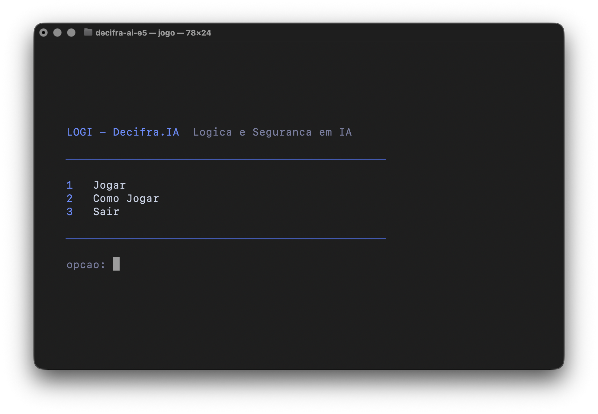

**Tela de inicialização**

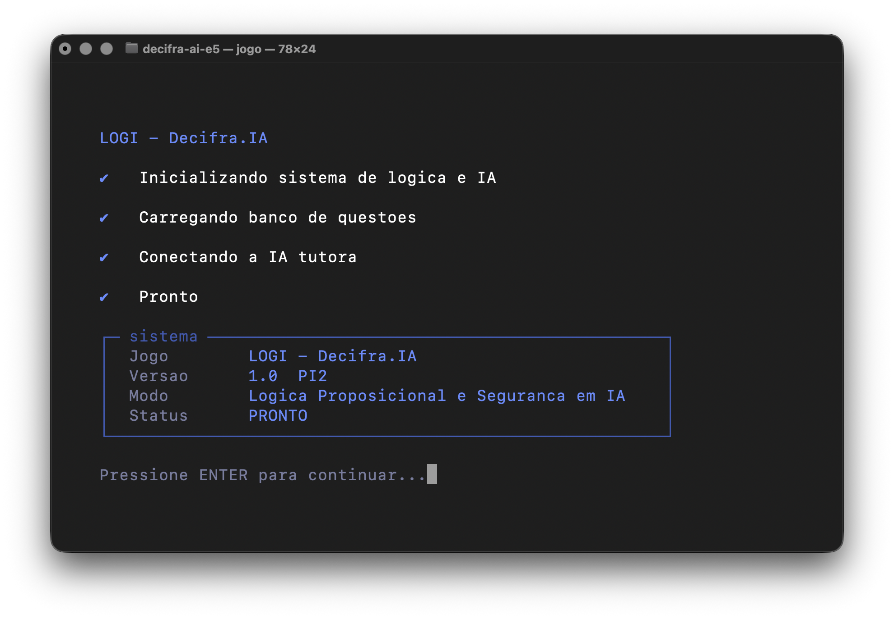

**Como Jogar**

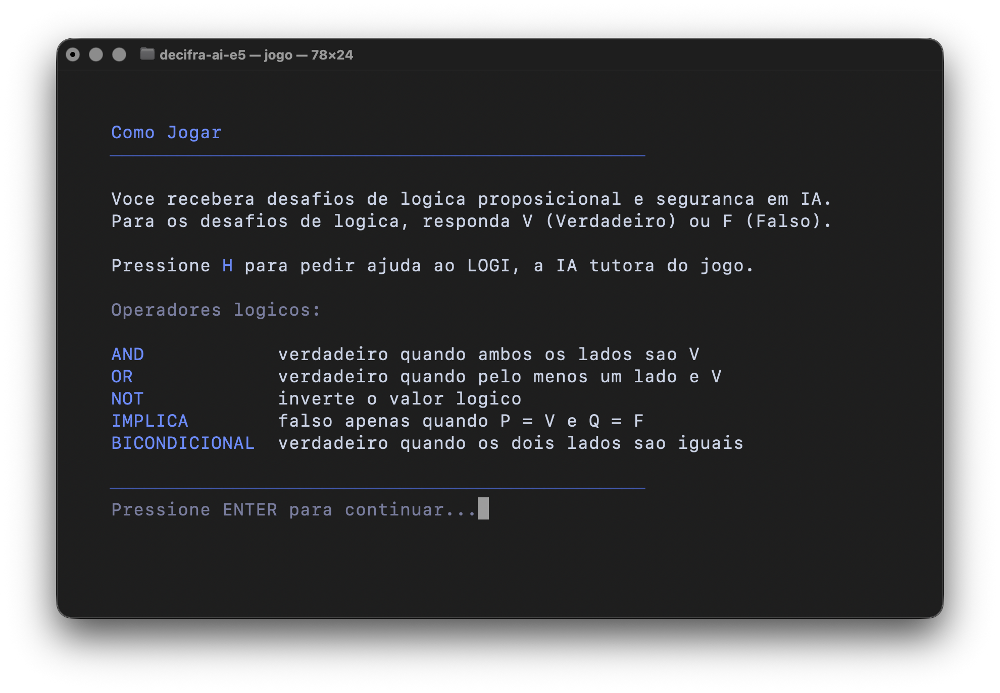

**Feedback de resposta correta**

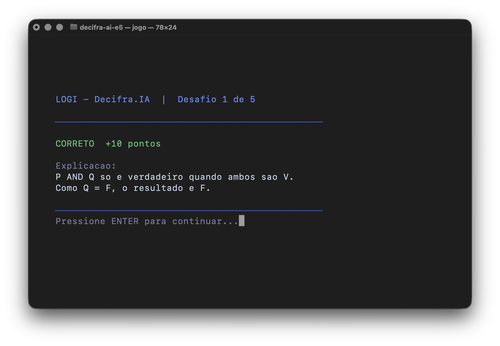

**Tutora LOGI — dica contextual**

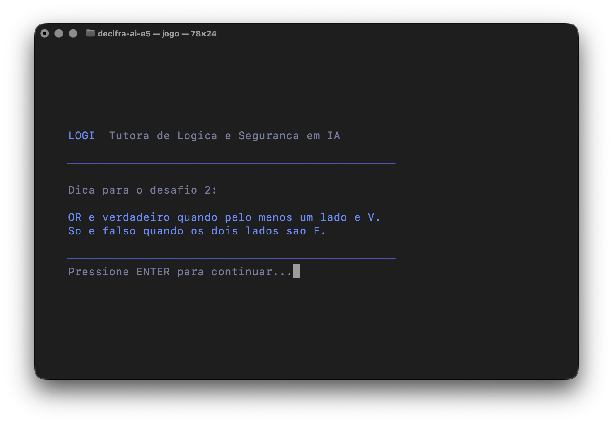

---

## Funcionalidades da UI

- **Alternate screen buffer** — o jogo roda como uma CLI isolada, sem rolar o terminal
- **Posicionamento absoluto de cursor** — nenhuma tela causa scroll; todo conteúdo é impresso em coordenadas fixas via `\033[row;colH`
- **Fade-in simultâneo em tela cheia** — todas as linhas aparecem juntas com brilho crescente via ANSI true-color RGB
- **Spinner braille animado** (⠋⠙⠹⠸⠼⠴⠦⠧⠇⠏ → ✔) nas telas de loading e saída
- **Paleta azul** derivada da identidade visual LOGI (#12122A em variantes mais claras)
- **Respostas V/F** sem diferenciação de maiúsculas/minúsculas
- **Sinal SIGINT capturado** — Ctrl+C restaura o terminal corretamente

---

## Equipe

| Integrante | Frente |
|---|---|
| Guilherme Alves de Souza | Gestão Ágil + Engenharia de Software |
| Hilton Resende | Gestão Ágil |
| João Guilherme Azevedo | Gestão Ágil |
| João Bezerra | Engenharia de Software |
| João Antonio Calazans | Design de Interação (IHC) |
| Pedro Feitosa | Lógica Matemática (LMC) |
| Ademir Pedro da Silva Filho | Motor em C (PIF) |
| Arthur Vieira Neiva Souza | Haskell (PIF) |
| Augusto Freitas Wanderley | Engenharia de Software |

---

## Estrutura do Projeto

```
logi-decifra-ai/
│
├── .github/
│   └── workflows/
│       └── build.yml         # CI/CD: Compilação automática no GitHub Actions
│
├── assets/
│   └── audio/                # Recursos de áudio (US15)
│       ├── menu.mp3          # Trilha sonora do menu principal
│       ├── gameplay.mp3      # Trilha sonora durante os desafios
│       ├── win.mp3           # Efeito sonoro de acerto
│       └── lose.mp3          # Efeito sonoro de erro/timeout
│
├── docs/                     # Documentação técnica e acadêmica (PI2-98 / PI2-99)
│   ├── diagrams/             # Diagramas de atividades e arquitetura (PNG)
│   ├── screenshots/          # Evidências visuais (prints do terminal e Jira)
│   ├── arquitetura.md        # Documento de arquitetura do sistema
│   ├── casos_testes_logicos.md
│   ├── fundamentos_logica_proposicional.md
│   ├── plano_de_testes.md    # Plano de testes unitários e de sistema
│   ├── proposicoes-logicas.md
│   ├── relatorio-tecnico.md
│   ├── requisitos_relatorio.md # Documento de Requisitos (RF e RNF)
│   ├── tabelas_verdade_proposicoes_logicas.md
│   └── tabelas-verdade.md
│
├── include/                  # Arquivos de cabeçalho (.h) - Contratos das APIs
│   ├── ai_client.h           # Interface de comunicação com a LOGI
│   ├── audio.h               # Gerenciamento de áudio (US15)
│   ├── colors.h              # Definições de cores ANSI (RGB)
│   ├── game.h                # Structs, enums e protótipos do núcleo do jogo
│   ├── input.h               # Leitura de teclado em modo raw (sem Enter)
│   └── ui.h                  # Protótipos das telas e renderizações
│
├── scripts/                  # Scripts auxiliares (Integração Python/IA)
│   ├── ai_client.py          # Bridge de comunicação com o modelo LLM
│   ├── local_server.py       # Servidor local para testes da IA
│   ├── modal_server.py       # Deploy do modelo no Modal (Cloud)
│   └── requirements.txt      # Dependências Python
│
├── src/                      # Código-fonte em C (.c)
│   ├── main.c                # Ponto de entrada, loop principal e roteamento do menu
│   ├── game.c                # Parser lógico, geração de tabela-verdade, economia e regras
│   ├── ui.c                  # Renderização ANSI, animações (fade/loading/timer) e telas
│   ├── input.c               # Captura de inputs do usuário (V, F, H, N)
│   ├── ai_client.c           # Cliente C para requisição de dicas (com fallback local)
│   └── audio.c               # Execução assíncrona de áudio (ffplay/system)
│
├── tests/                    # Testes de software
│
├── .gitignore                # Arquivos ignorados pelo Git (binários, objetos)
├── Makefile                  # Automação de build (make, make run, make clean)
└── README.md                 # Documentação principal do repositório
```

---

## Como compilar e rodar

### Pré-requisitos

- gcc
- make

### Instalação das dependências

**Ubuntu/Debian:**
```bash
sudo apt update
sudo apt install build-essential
```

**macOS:**
```bash
xcode-select --install
```

**Windows (recomendado usar WSL):**
```powershell
wsl --install
# Após reiniciar:
sudo apt update
sudo apt install build-essential
```

### Build e execução

```bash
make          # Compila
make run      # Compila e executa
make clean    # Limpa arquivos compilados
```

---

## Roadmap

### Unidade 1 — concluído

- [x] Telas com navegação completa e alternate screen buffer
- [x] Animações fade-in simultâneo com ANSI true-color e spinner braille
- [x] Parser recursivo de descida para expressões lógicas (`eval_expr` / `eval_or` / `eval_and` / `eval_not` / `eval_impl` — `src/game.c`)
- [x] Geração dinâmica de desafios via RNG (`/dev/urandom`) com cobertura de 2^n combinações (HU10)
- [x] Banco de 10 desafios cobrindo AND, OR, NOT, IMPLICA, BICONDICIONAL e expressões com 3 variáveis (HU1–HU6)
- [x] Nível Avançado com expressões compostas e parênteses (opção 4 do menu, HU12)
- [x] Modo Contra-Tempo com bônus de velocidade e timer de 20s (opção 5 do menu, HU11)
- [x] Dica contextual inline da LOGI ao pressionar H (HU8)
- [x] Integração com modelo LOGI via bridge C → Python + GGUF (llama-cpp-python) — modelo v5 treinado com 13.000 exemplos (QLoRA, Qwen2.5-1.5B-Instruct, rank 32) · [ver modelo no HuggingFace](https://huggingface.co/guiiwfz/logi-1.5b-gguf)
- [x] Persistência local do highscore em `~/.decifra_score` (Unidade 2, sprint 12)

### Unidade 2 — em andamento

- [ ] Motor de lógica proposicional em Haskell
- [ ] Modo narrativo com falas contextuais da LOGI entre desafios
- [ ] Tela de ranking com top-5 histórico

---

## Integração LOGI — Decisão de plataforma

O modelo LOGI é um fine-tune QLoRA sobre Qwen2.5-1.5B-Instruct, treinado com 13.000 exemplos de lógica proposicional. Foi testado em duas plataformas de deploy durante o SPIKE (PI2-125):

| Plataforma | Latência média | Custo | Status |
|---|---|---|---|
| **HuggingFace Spaces** (llama-cpp-python + GGUF v5) | ~2–4 s/req | gratuito (tier free) | Testado — PI2-150 |
| **Local** (llama-cpp-python direto) | ~1–3 s/req | zero | Opção de fallback |
| Modal | — | pago por requisição | Descartado para U2 |

**Decisão:** o jogo usa o modelo localmente via `llama-cpp-python` + bridge `popen` em `src/ai_client.c`. O deploy no HuggingFace Spaces serve como fallback para ambientes sem GPU. O Modal foi descartado para esta unidade por exigir faturamento e não adicionar benefício técnico sobre o deploy local.

Para rodar com LOGI ativo, instale as dependências Python e exporte o caminho do modelo:

```bash
pip install llama-cpp-python
export LOGI_MODEL_PATH=/caminho/para/logi-1.5b-v5.gguf
make run
```

Sem `LOGI_MODEL_PATH`, o jogo roda normalmente mas a dica da LOGI exibe a explicação estática do campo `explicacao[]` do struct `Desafio`.

---

## Convenção de branches

| Branch | Uso |
|---|---|
| `main` | Código estável, entregas |
| `develop` | Integração contínua |
| `feat/nome` | Desenvolvimento de funcionalidades |

---

## Histórias de Usuário

https://docs.google.com/document/d/1SzixVp4eZ87xHs2-ZFUsQz371UWR0J6m4fWdXbj5Fig/edit?usp=sharing

### Diagramas de Fluxo (HU1 a HU12)

### HU1 - Proposições Compostas com o operador AND
<details>
  <summary>Clique para visualizar o Diagrama HU1</summary>
  
  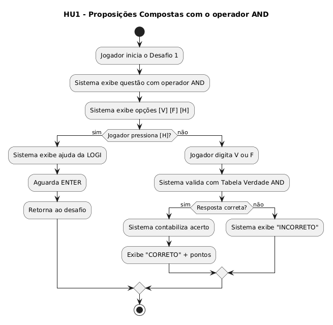
</details>

### HU2 - Conectivos Binários no Nível 1
<details>
  <summary>Clique para visualizar o Diagrama HU2</summary>
  
  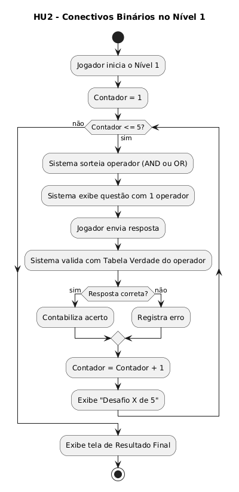
</details>

### HU3 - Fórmulas com Implicação e Bicondicional
<details>
  <summary>Clique para visualizar o Diagrama HU3</summary>
  
  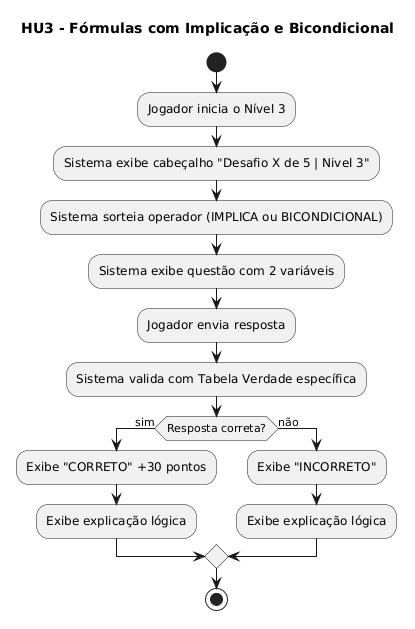
</details>

### HU4 - Feedback e Explicações Lógicas
<details>
  <summary>Clique para visualizar o Diagrama HU4</summary>
  
  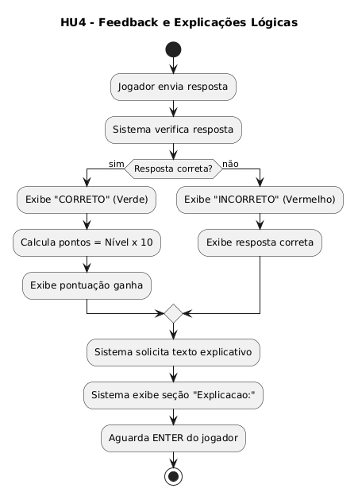
</details>

### HU5 - Regras de Progressão de Nível
<details>
  <summary>Clique para visualizar o Diagrama HU5</summary>
  
  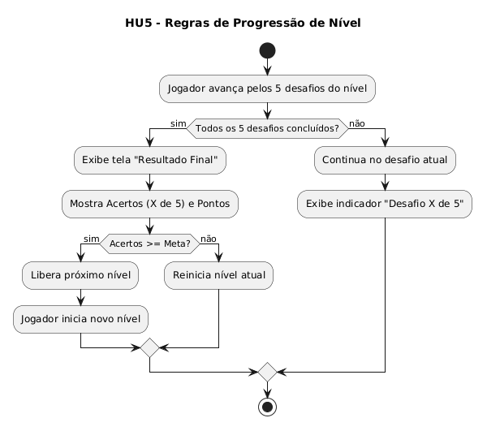
</details>

### HU6 - Notação Padronizada dos Operadores
<details>
  <summary>Clique para visualizar o Diagrama HU6</summary>
  
  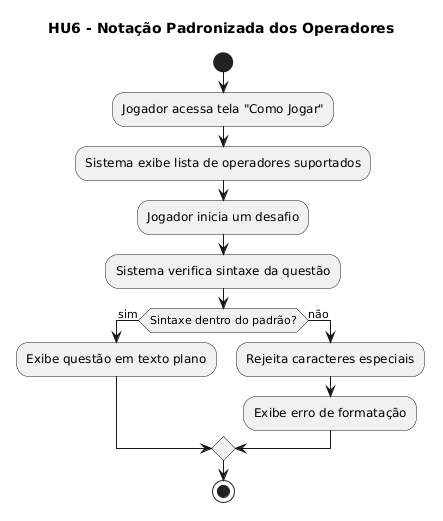
</details>

### HU7 - Feedback Imediato de Resposta
<details>
  <summary>Clique para visualizar o Diagrama HU7</summary>
  
  
</details>

### HU8 - Sistema de Ajuda Contextual (Tutora LOGI)
<details>
  <summary>Clique para visualizar o Diagrama HU8</summary>
  
  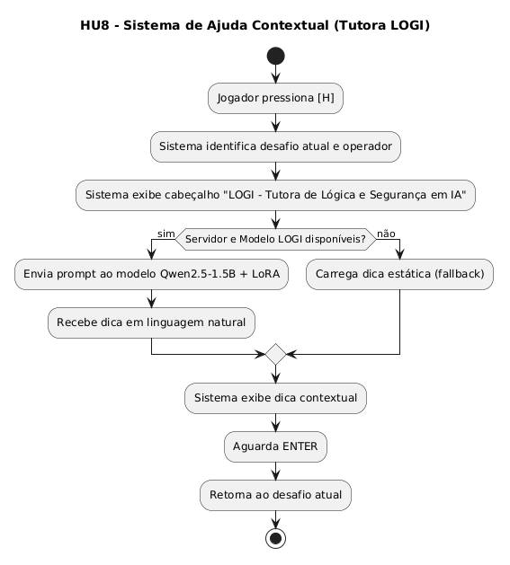
</details>

### HU9 - Exemplos Didáticos de Escopo
<details>
  <summary>Clique para visualizar o Diagrama HU9</summary>
  
  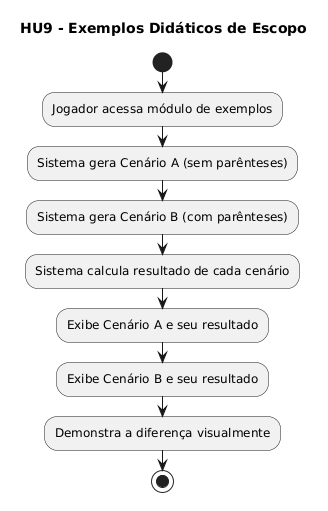
</details>

### HU10 - Cobertura de Combinações (2^n)
<details>
  <summary>Clique para visualizar o Diagrama HU10</summary>
  
  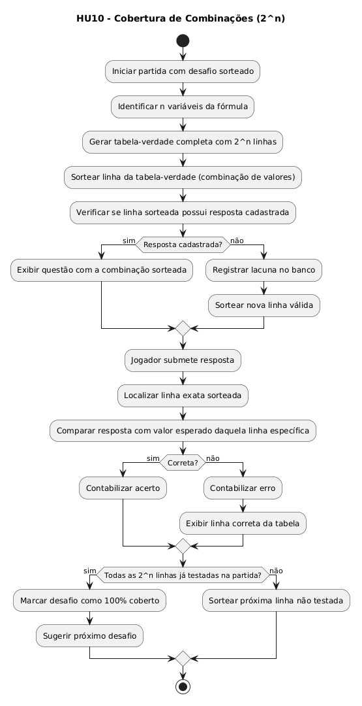
</details>

### HU11 - Modo Contra-Tempo
<details>
  <summary>Clique para visualizar o Diagrama HU11</summary>
  
  
</details>

### HU12 - Nível Avançado com Parênteses
<details>
  <summary>Clique para visualizar o Diagrama HU12</summary>
  
  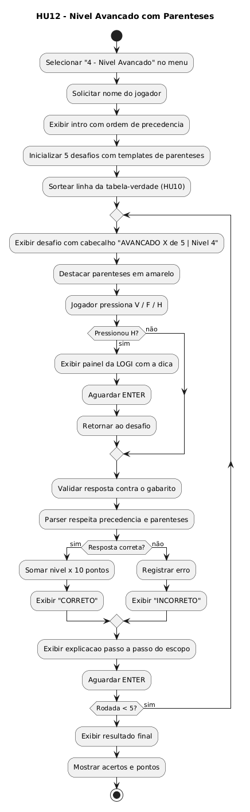
</details>

---

## Screencast
https://youtu.be/Iltjfxjm8z0

**demo HU13eHU14: https://www.youtube.com/watch?v=My1l-SniFo8

**demo HU15: https://www.youtube.com/watch?v=jyQQGYnBtwE

## Storyboard(figma)
https://www.figma.com/design/sVscUjtksFLvERPGbrisHb/LOGI-Decifra.IA---Wireframes-IHC?node-id=45-103&t=IGlyCabXOWPoepC9-1

### Protótipos e Telas do Jogo (Screenshots)
*(Como você já tem a pasta `screenshots`, pode adicionar os prints aqui também)*

| Tela | Descrição | Link |
| :--- | :--- | :--- |
| **01** | Menu Principal | [Ver Print](./docs/screenshots/01-menu-principal.png) |
| **02** | Como Jogar | [Ver Print](./docs/screenshots/02-como-jogar.png) |
| **03** | Inicialização | [Ver Print](./docs/screenshots/03-inicializacao.png) |
| **04** | Resposta Correta | [Ver Print](./docs/screenshots/04-resposta-correta.png) |
| **05** | Tutora LOGI | [Ver Print](./docs/screenshots/05-tutora-logi.png) |

## Backlog


---

## Board


## Bug Tracker


## Programação em Pares

O desenvolvimento da Entrega 3 de FDS foi conduzido de forma colaborativa. A equipe utilizou o **Jira** para centralizar as discussões, registrar as ideias de features (brainstorming) e distribuir as tarefas, caracterizando um trabalho conjunto entre a concepção e a implementação.

*   **João Antonio Calazans:** Idealizou a mecânica de recompensas e o **Sistema de Lootbox (US13)**.
*   **Arthur Vieira Neiva Souza:** Propôs a inclusão de **Trilha Sonora e Áudio (US15)** para aumentar a imersão do jogador.
*   **Ademir Pedro da Silva Filho:** Idealizou o **Sistema Monetário e a Loja (US14)** para dar sentido à progressão do jogador.
*   **Augusto Freitas Wanderley:** Atuou durante a implementação no VS Code e na gravação das últimas três histórias (US13, US14 e US15).
  *Nota: Toda equipe trabalhou em conjunto, estes 4 acima foram essenciais na idealização das histórias de usuário na disciplina de FDS(Fundamentos de Desenvolvimento de Software)*

## Evidências de Colaboração
As interações da equipe, a validação das ideias e a divisão de tarefas podem ser comprovadas através do nosso board e histórico de comentários no Jira.


---

## Licença

Projeto acadêmico - CESAR School 2026.
