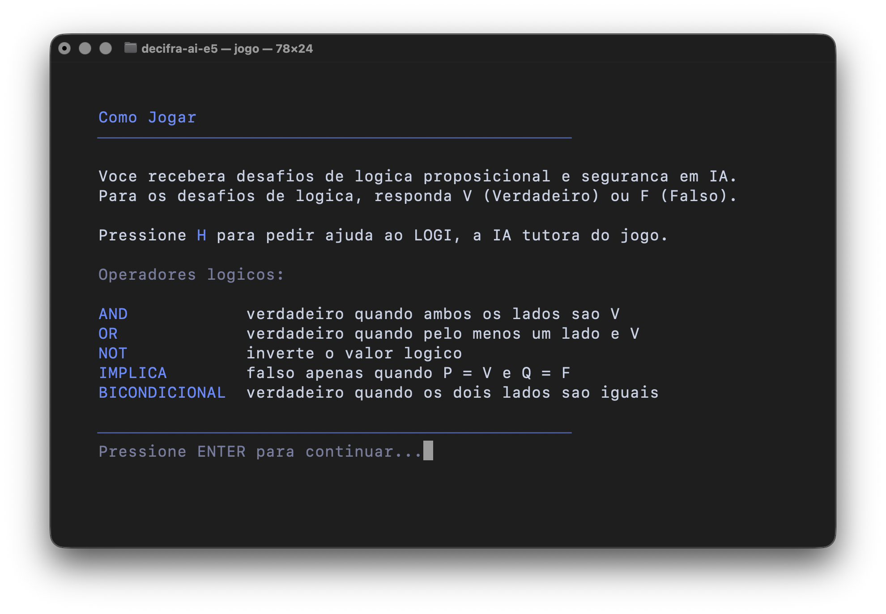
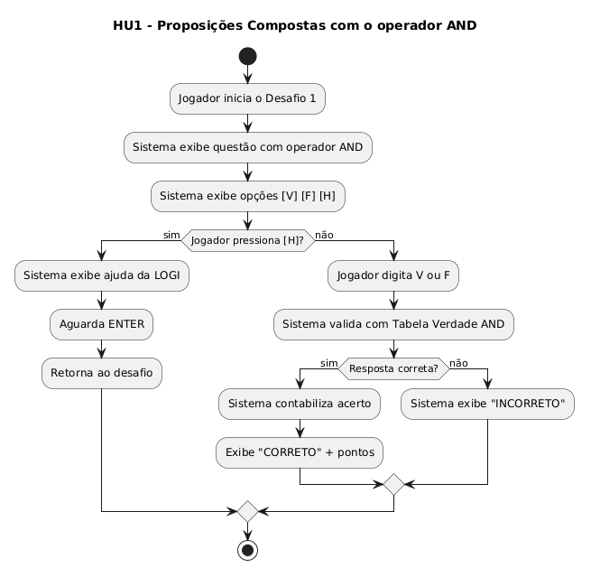
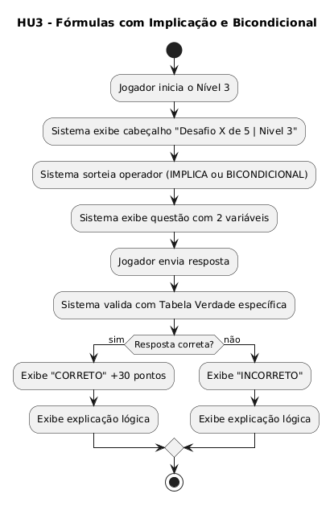
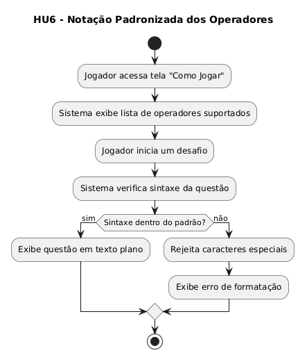
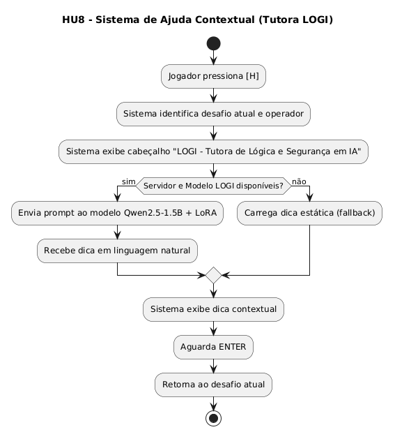
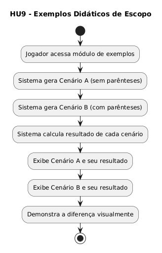
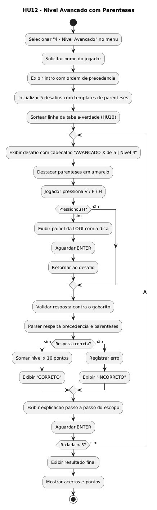

# LOGI - Decifra.IA


Jogo educacional de terminal que une lógica proposicional e conscientização sobre Inteligência Artificial.

Desenvolvido por Squad 05 como Projeto Integrador 2P - E5 no CESAR School.

Implementado em **C** na Unidade 1 e **Haskell** na Unidade 2.

---

## Sobre o Jogo

Você está em 2031. A IA já permeia tudo: contrata, diagnostica, julga, governa. A maioria das pessoas apenas aceita as respostas que ela dá.

Mas você conheceu a **LOGI**.

LOGI não é um chatbot qualquer. Ela é uma IA tutora criada para ensinar o que poucos ainda dominam: **pensar com rigor lógico**. Ela acredita que a melhor defesa contra uma IA opaca é um humano que sabe raciocinar.

A cada sessão, LOGI te apresenta desafios de lógica proposicional, os mesmos fundamentos matemáticos que estão por trás de qualquer sistema de IA. Ela explica operadores como AND, OR, NOT, IMPLICA e BICONDICIONAL não como curiosidades acadêmicas, mas como ferramentas de pensamento crítico para o mundo que vivemos.

Entre cada desafio, ela conta um pouco sobre como a IA funciona, onde ela erra, o que ela não consegue fazer sozinha, e por que você, humano, ainda importa.

**Decifre as proposições. Questione as máquinas. Pense por conta própria.**

---

## O que o jogo ensina

### Lógica Proposicional

| Operador | Regra |
|---|---|
| `AND` | verdadeiro apenas quando ambos os lados são V |
| `OR` | verdadeiro quando pelo menos um lado é V |
| `NOT` | inverte o valor lógico |
| `IMPLICA` | falso apenas quando P = V e Q = F |
| `BICONDICIONAL` | verdadeiro quando os dois lados têm o mesmo valor |

### Conscientização em IA

O jogo aborda de forma narrativa temas como:

- Viés algorítmico — quando a IA reflete os preconceitos dos dados com que foi treinada
- Opacidade de modelos — o problema da "caixa preta" e a dificuldade de auditar decisões automáticas
- Falsas certezas — por que alta acurácia em treino não garante segurança no mundo real
- Papel humano — o lugar do pensamento crítico e da responsabilidade em sistemas híbridos

---
## Fluxo do Jogo

```
Menu principal (7 opções)
├── 1. Jogar (nível básico)
│   ├── Loading -> Informe seu nome
│   ├── Desafios 1-5 (AND/OR/NOT/IMPLICA/BICONDICIONAL, 2 variáveis)
│   │   ├── [V]/[F] resposta | [H] pedir dica à LOGI
│   │   └── Feedback: acerto/erro + explicação + pontuação + moedas
│   └── Resultado final
├── 2. Como Jogar (regras e operadores)
├── 3. Exemplos de Escopo (casos didáticos)
├── 4. Nível Avançado
│   ├── Desafios 6-10 (expressões compostas, 3 variáveis, parênteses)
│   └── Mesmo fluxo V/F/H do nível básico
├── 5. Contra-Tempo
│   ├── Timer de 20s por desafio
│   └── Bônus +50% se responder em até 10s, +25% em até 15s
├── 6. Loja de Itens e Lootbox
│   ├── Comprar Dica (15 moedas) | Comprar Lootbox (30 moedas)
│   └── Animação e sorteio de prêmios aleatórios
└── 7. Sair
```

---

## Screenshots

**Menu principal**


**Tela de inicialização**


**Como Jogar**



**Feedback de resposta correta**


**Tutora LOGI — dica contextual**


---

## Funcionalidades da UI

- **Alternate screen buffer** — o jogo roda como uma CLI isolada, sem rolar o terminal
- **Posicionamento absoluto de cursor** — nenhuma tela causa scroll; todo conteúdo é impresso em coordenadas fixas via `\033[row;colH`
- **Fade-in simultâneo em tela cheia** — todas as linhas aparecem juntas com brilho crescente via ANSI true-color RGB
- **Spinner braille animado** (⠋⠙⠹⠸⠼⠴⠦⠧⠇⠏ → ✔) nas telas de loading e saída
- **Paleta azul** derivada da identidade visual LOGI (#12122A em variantes mais claras)
- **Respostas V/F** sem diferenciação de maiúsculas/minúsculas
- **Sinal SIGINT capturado** — Ctrl+C restaura o terminal corretamente

---

## Equipe

| Integrante | Frente |
|---|---|
| Guilherme Alves de Souza | Gestão Ágil + Engenharia de Software |
| Hilton Resende | Gestão Ágil |
| João Guilherme Azevedo | Gestão Ágil |
| João Bezerra | Engenharia de Software |
| João Antonio Calazans | Design de Interação (IHC) |
| Pedro Feitosa | Lógica Matemática (LMC) |
| Ademir Pedro da Silva Filho | Motor em C (PIF) |
| Arthur Vieira Neiva Souza | Haskell (PIF) |
| Augusto Freitas Wanderley | Engenharia de Software |

---

## Estrutura do Projeto

```
logi-decifra-ai/
│
├── .github/
│   └── workflows/
│       └── build.yml         # CI/CD: Compilação automática no GitHub Actions
│
├── assets/
│   └── audio/                # Recursos de áudio (US15)
│       ├── menu.mp3          # Trilha sonora do menu principal
│       ├── gameplay.mp3      # Trilha sonora durante os desafios
│       ├── win.mp3           # Efeito sonoro de acerto
│       └── lose.mp3          # Efeito sonoro de erro/timeout
│
├── docs/                     # Documentação técnica e acadêmica (PI2-98 / PI2-99)
│   ├── diagrams/             # Diagramas de atividades e arquitetura (PNG)
│   ├── screenshots/          # Evidências visuais (prints do terminal e Jira)
│   ├── arquitetura.md        # Documento de arquitetura do sistema
│   ├── casos_testes_logicos.md
│   ├── fundamentos_logica_proposicional.md
│   ├── plano_de_testes.md    # Plano de testes unitários e de sistema
│   ├── proposicoes-logicas.md
│   ├── relatorio-tecnico.md
│   ├── requisitos_relatorio.md # Documento de Requisitos (RF e RNF)
│   ├── tabelas_verdade_proposicoes_logicas.md
│   └── tabelas-verdade.md
│
├── include/                  # Arquivos de cabeçalho (.h) - Contratos das APIs
│   ├── ai_client.h           # Interface de comunicação com a LOGI
│   ├── audio.h               # Gerenciamento de áudio (US15)
│   ├── colors.h              # Definições de cores ANSI (RGB)
│   ├── game.h                # Structs, enums e protótipos do núcleo do jogo
│   ├── input.h               # Leitura de teclado em modo raw (sem Enter)
│   └── ui.h                  # Protótipos das telas e renderizações
│
├── scripts/                  # Scripts auxiliares (Integração Python/IA)
│   ├── ai_client.py          # Bridge Python para o modelo LLM (local → HuggingFace; não chamado pelo binário C)
│   ├── local_server.py       # Servidor local para testes da IA
│   ├── modal_server.py       # Deploy do modelo no Modal (Cloud)
│   └── requirements.txt      # Dependências Python
│
├── src/                      # Código-fonte em C (.c)
│   ├── main.c                # Ponto de entrada, loop principal e roteamento do menu
│   ├── game.c                # Parser lógico, geração de tabela-verdade, economia e regras
│   ├── ui.c                  # Renderização ANSI, animações (fade/loading/timer) e telas
│   ├── input.c               # Captura de inputs do usuário (V, F, H, N)
│   ├── ai_client.c           # Dicas determinísticas baseadas nos operadores do enunciado (AND/OR/NOT/IMPLICA/BICONDICIONAL)
│   └── audio.c               # Execução assíncrona de áudio (ffplay/system)
│
├── tests/                    # Testes de software
│
├── .gitignore                # Arquivos ignorados pelo Git (binários, objetos)
├── Makefile                  # Automação de build (make, make run, make clean)
└── README.md                 # Documentação principal do repositório
```

---

## Tecnologias

- **C (C11)** com `gcc` e `make`
- **raylib**: interface gráfica (`make run-gui`)
- **ANSI/termios**: interface de terminal
- **ffplay (ffmpeg)**: trilha sonora (opcional)
- **GitHub Actions**: compilação, `cppcheck` e testes a cada push e PR
- **Jira**: backlog e board

## Como compilar e rodar

### Pré-requisitos

- gcc
- make

### Instalação das dependências

**Ubuntu/Debian:**
```bash
sudo apt update
sudo apt install build-essential
```

**macOS:**
```bash
xcode-select --install
```

**Windows (recomendado usar WSL):**
```powershell
wsl --install
# Após reiniciar:
sudo apt update
sudo apt install build-essential
```

### Build e execução

```bash
make          # Compila
make run      # Compila e executa
make clean    # Limpa arquivos compilados
```
Testes automatizados

    make test     # compila e roda tests/test_runner.c

A saída esperada termina com `58 testes, 0 falha(s)`.

Para configurar o ambiente do zero (incluindo a raylib) e contribuir, veja o [CONTRIBUTING.md](CONTRIBUTING.md).

### Interface gráfica (raylib)

Além do jogo de terminal, existe uma versão com janela gráfica (PI2-189), com as mesmas regras, modos, loja e narração da LOGI:

```bash
make gui      # Compila ./jogo_gui
make run-gui  # Compila e executa
```

Requer a [raylib](https://www.raylib.com/) instalada (no Ubuntu: `sudo apt update && sudo apt install libraylib-dev`; se o pacote não existir na sua versão, compile a raylib pelo código-fonte conforme o site). No WSL, a janela abre via WSLg (Windows 10/11 atualizado). Use o teclado (V, F, H, P, T, 1-8, ENTER) ou clique nos botões. A fonte padrão da raylib não tem acentos, então os textos seguem sem acento.

---

## Roadmap

### Unidade 1 — concluído

- [x] Telas com navegação completa e alternate screen buffer
- [x] Animações fade-in simultâneo com ANSI true-color e spinner braille
- [x] Parser recursivo de descida para expressões lógicas (`eval_expr` / `eval_or` / `eval_and` / `eval_not` / `eval_impl` — `src/game.c`)
- [x] Geração dinâmica de desafios via RNG (`/dev/urandom`) com cobertura de 2^n combinações (HU10)
- [x] Banco de 10 desafios cobrindo AND, OR, NOT, IMPLICA, BICONDICIONAL e expressões com 3 variáveis (HU1–HU6)
- [x] Nível Avançado com expressões compostas e parênteses (opção 4 do menu, HU12)
- [x] Modo Contra-Tempo com bônus de velocidade e timer de 20s (opção 5 do menu, HU11)
- [x] Dica contextual inline da LOGI ao pressionar H (HU8)
- [x] Integração de dicas contextuais via `src/ai_client.c` — lógica determinística que identifica operadores (AND/OR/NOT/IMPLICA/BICONDICIONAL) no enunciado e retorna a regra correspondente; `scripts/ai_client.py` implementa bridge Python para o modelo Qwen2.5-1.5B no HuggingFace (disponível para integração futura) · [ver modelo no HuggingFace](https://huggingface.co/guiiwfz/logi-1.5b-gguf)
- [x] Persistência local do highscore em `~/.decifra_score` (Unidade 2, sprint 12)

### Unidade 2 — em andamento

- [ ] Motor de lógica proposicional em Haskell
- [x] Modo narrativo com falas contextuais da LOGI entre desafios
- [x] Tela de ranking com top-5 histórico (US19)
- [x] Modo Sobrevivência — desafios contínuos com eliminação por erro (US20)

---

## Integração LOGI — Arquitetura de dicas

O sistema de dicas da LOGI opera em duas camadas independentes:

**Camada C (executável):** `src/ai_client.c` implementa `ai_consultar()` — função determinística que analisa o enunciado do desafio, identifica os operadores lógicos presentes (AND, OR, NOT, IMPLICA, BICONDICIONAL) e retorna a regra correspondente como string. Sem chamadas externas, sem `popen`, sem dependências Python. Esta é a camada ativa no binário compilado.

**Camada Python (disponível, não conectada ao binário):** `scripts/ai_client.py` é uma bridge real para o modelo Qwen2.5-1.5B-Instruct (fine-tune QLoRA, 13.000 exemplos, rank 32), tentando primeiro um servidor local (`http://127.0.0.1:8787/ask`) com fallback para o HuggingFace Spaces. O script funciona de forma autônoma mas não é chamado pelo executável C.

| Plataforma | Latência média | Custo | Status |
|---|---|---|---|
| **HuggingFace Spaces** (Qwen2.5-1.5B GGUF v5) | ~2–4 s/req | gratuito (tier free) | Testado — PI2-150 |
| **Local** (`local_server.py`) | ~1–3 s/req | zero | Opção de fallback |
| Modal | — | pago por requisição | Descartado para U2 |

Para usar a bridge Python de forma independente:

```bash
pip install -r scripts/requirements.txt
python scripts/ai_client.py "P AND Q"
```

---

## Convenção de branches

| Branch | Uso |
|---|---|
| `main` | Código estável, entregas |
| `develop` | Integração contínua |
| `feat/nome` | Desenvolvimento de funcionalidades |

---

## Histórias de Usuário (HU1 até HU25)

https://docs.google.com/document/d/1SzixVp4eZ87xHs2-ZFUsQz371UWR0J6m4fWdXbj5Fig/edit?usp=sharing

### Diagramas de Fluxo (HU1 até HU12)

### HU1 - Proposições Compostas com o operador AND
<details>
  <summary>Clique para visualizar o Diagrama HU1</summary>
  
  
</details>

### HU2 - Conectivos Binários no Nível 1
<details>
  <summary>Clique para visualizar o Diagrama HU2</summary>
  
  
</details>

### HU3 - Fórmulas com Implicação e Bicondicional
<details>
  <summary>Clique para visualizar o Diagrama HU3</summary>
  
  
</details>

### HU4 - Feedback e Explicações Lógicas
<details>
  <summary>Clique para visualizar o Diagrama HU4</summary>
  
  
</details>

### HU5 - Regras de Progressão de Nível
<details>
  <summary>Clique para visualizar o Diagrama HU5</summary>
  
  
</details>

### HU6 - Notação Padronizada dos Operadores
<details>
  <summary>Clique para visualizar o Diagrama HU6</summary>
  
  
</details>

### HU7 - Feedback Imediato de Resposta
<details>
  <summary>Clique para visualizar o Diagrama HU7</summary>
  
  
</details>

### HU8 - Sistema de Ajuda Contextual (Tutora LOGI)
<details>
  <summary>Clique para visualizar o Diagrama HU8</summary>
  
  
</details>

### HU9 - Exemplos Didáticos de Escopo
<details>
  <summary>Clique para visualizar o Diagrama HU9</summary>
  
  
</details>

### HU10 - Cobertura de Combinações (2^n)
<details>
  <summary>Clique para visualizar o Diagrama HU10</summary>
  
  
</details>

### HU11 - Modo Contra-Tempo
<details>
  <summary>Clique para visualizar o Diagrama HU11</summary>
  
  
</details>

### HU12 - Nível Avançado com Parênteses
<details>
  <summary>Clique para visualizar o Diagrama HU12</summary>
  
  
</details>

### HU13 - Sistema de Lootbox (Caixas de Recompensa)
<details>
  <summary>Clique para visualizar mais detalhes</summary>
  
Cartão: Como jogador, quero abrir caixas de recompensa (lootboxes) com moedas do jogo, para ganhar itens bônus aleatórios que me ajudem nas partidas e me motivem a continuar jogando.
Conversa: Implementar um sistema de lootbox acessível pela Loja. Ao ser acionada, a tela deve exibir uma animação simples em ASCII ([ ? ] piscando) para simular a abertura da caixa. O sistema deve sortear um prêmio entre três opções: Pontos Extras, Moedas Extras ou Dicas Grátis, atualizando o saldo do jogador imediatamente.
Confirmação:
Exibir a animação de abertura da caixa antes de revelar o prêmio.
Sortear aleatoriamente entre os três prêmios: +50 Pontos, +20 Moedas ou +2 Dicas Grátis.
Atualizar o jogador (pontuação, moedas ou dicas) com o prêmio sorteado.
Exibir a tela de resultado do prêmio com a mensagem clara do que foi ganho.
Consumir o valor da compra da Lootbox (30 Moedas) antes de iniciar a animação.
Cenário BDD:
Dado que o jogador está na Loja e possui saldo igual ou superior a 30 Moedas,
Quando ele seleciona a opção de comprar e abrir uma Lootbox,
Então o sistema deve deduzir 30 Moedas, exibir a animação de abertura da caixa, sortear um prêmio aleatório (Pontos, Moedas ou Dicas) e atualizar o inventário do jogador na mesma tela.


</details>

### HU14 - Sistema Monetário e Loja de Itens
<details>
  <summary>Clique para visualizar mais detalhes</summary>
  Cartão: Como jogador, quero ganhar moedas ao acertar desafios e ter uma loja para gastá-las, para comprar vantagens (como dicas gratuitas) que me ajudem nos modos de jogo mais difíceis.
Conversa: Adicionar uma economia ao jogo. O jogador deve ganhar moedas a cada acerto (proporcional ao nível do desafio). Criar uma nova opção 6 Loja no menu principal, onde o jogador pode ver seu saldo e comprar Dicas Grátis (15 Moedas). As dicas compradas devem ser consumidas automaticamente ao pressionar [H] no modo Contra-Tempo, permitindo que o jogador veja a explicação da LOGI sem perder o bônus de velocidade. O saldo de moedas deve ser exibido no cabeçalho dos desafios.
Confirmação:
Adicionar campo de moedas e dicas_gratis ao perfil do jogador.
Recompensar o jogador com nível × 2 moedas por acerto nas rodadas.
Exibir o saldo atualizado no cabeçalho das telas de desafio e na tela da Loja.
Criar a opção 6 Loja de Itens no menu principal (deslocando "Sair" para a opção 7).
Permitir a compra de Dica Grátis (15 Moedas) e Lootbox (30 Moedas).
Exibir aviso de "Moedas insuficientes!" caso o saldo não cubra o custo.
No Contra-Tempo, se o jogador tiver dicas_gratis > 0, o uso do [H] consome 1 dica e mantém o direito ao bônus de velocidade.
Cenário BDD:
Dado que o jogador acumulou moedas ao longo das partidas,
Quando ele acessa a Loja (Opção 6), compra uma Dica Grátis e depois entra no modo Contra-Tempo,
Então o sistema deve deduzir 15 moedas do saldo, incrementar o contador de dicas, exibir o novo saldo no cabeçalho do desafio e, ao pressionar [H] durante a partida, consumir a dica gratuita sem desativar o cálculo de bônus por tempo.

</details>

### HU15 - Trilha Sonora e Músicas por Cenário
<details>
  <summary>Clique para visualizar mais detalhes</summary>
  Cartão: Como jogador, quero ouvir músicas de fundo e efeitos sonoros contextuais (menu, gameplay, vitória, derrota), para ter uma experiência mais imersiva e receber feedback auditivo imediato das minhas ações.
Conversa: Implementar um sistema de áudio em C que reproduza arquivos .mp3 de forma assíncrona (em background), sem travar o fluxo do terminal ou a leitura de teclado. O sistema deve alternar as músicas de fundo dependendo da tela e disparar efeitos curtos ao acertar ou errar. Como o jogo roda em terminal, a execução deve usar uma ferramenta externa (como o ffplay do FFmpeg). O código deve ser tolerante a falhas: se o ambiente não tiver suporte a áudio (ex: WSL sem PulseAudio configurado), o jogo deve continuar rodando silenciosamente, sem quebrar.
Confirmação:


Iniciar a música menu.mp3 em loop ao carregar o menu principal.


Alternar para a música gameplay.mp3 em loop ao entrar em qualquer modo de desafio (Níveis 1-3, Avançado ou Contra-Tempo).


Tocar o efeito win.mp3 ao acertar uma questão.


Tocar o efeito lose.mp3 ao errar uma questão ou quando o tempo esgotar.


Interromper qualquer áudio em reprodução ao sair do jogo (Opção Sair ou Ctrl+C).


Não bloquear o terminal: o jogador deve conseguir ler a tela e digitar a resposta enquanto a música toca.


Caso o player de áudio não esteja instalado ou o dispositivo de som não exista, o jogo deve continuar normalmente em modo silencioso.


Cenário BDD:


Dado que o jogador iniciou o jogo e o sistema de áudio está disponível,


Quando ele navega pelo menu, inicia um desafio, ou responde a uma questão,


Então o sistema deve reproduzir as músicas e efeitos correspondentes (menu, gameplay, acerto ou erro) em background, sem travar a interface do terminal, e interromper todo o áudio ao encerrar o jogo.

</details>

### HU16 - Compra de Dica
<details>
  <summary>Clique para visualizar mais detalhes</summary>
  Cartão:
Como jogador, quero comprar uma dica para a pergunta atual usando minhas moedas, para avançar quando estiver travado sem precisar pular a questão.
Conversa:
Implementar um atalho ([H]) que permite comprar uma dica durante o desafio. O sistema deve verificar se o jogador possui moedas suficientes. Ao confirmar a compra em uma tela de aviso, o saldo é debitado e a tutora LOGI exibe uma dica parcial (explicando o operador lógico) sem revelar a resposta diretamente. O limite é de uma dica comprada por questão.
Confirmação:
Exibir a opção [H] com o custo em moedas na tela do desafio.
Ao acionar, exibir uma tela de confirmação ("Deseja comprar uma dica por 15 moedas?").
Se tiver saldo, debitar as moedas e exibir o painel da LOGI com a dica.
Se não tiver saldo, exibir mensagem "Moedas insuficientes!" e retornar à questão.
Bloquear a compra de uma segunda dica para a mesma questão.
A dica deve explicar a regra lógica sem dar a resposta V/F diretamente.
Cenário BDD:
Dado que o jogador está respondendo a um desafio e possui moedas suficientes,
Quando ele pressiona a tecla [H] e confirma a compra,
Então o sistema deve debitar o custo em moedas, exibir o painel da LOGI com a dica contextual e impedir uma nova compra de dica para esta mesma pergunta.

</details>

### HU17 - Alteração de Pergunta
<details>
  <summary>Clique para visualizar mais detalhes</summary>
Cartão:
Como jogador, quero trocar a pergunta atual por outra do mesmo nível usando minhas moedas, para continuar jogando quando a questão atual estiver fora do meu conhecimento.
Conversa:
Implementar o atalho [P] (Pular) durante o desafio. Ao confirmar a compra em uma tela de aviso, a pergunta atual é descartada e uma nova questão do mesmo nível e tema é gerada. Se o jogador estiver no modo Contra-Tempo, o temporizador deve ser reiniciado. A nova pergunta não pode ser idêntica à anterior. O limite é de uma troca por questão.
Confirmação:
Exibir a opção [P] com o custo em moedas na tela do desafio.
Ao acionar, exibir tela de confirmação ("Deseja pular esta pergunta por 20 moedas?").
Debitar o saldo, gerar uma nova questão do mesmo nível e renderizar na tela.
Reiniciar o temporizador caso esteja no modo Contra-Tempo.
Garantir que o novo enunciado seja diferente do anterior.
Se não tiver saldo, exibir mensagem de erro e manter a pergunta atual.
Cenário BDD:
Dado que o jogador está respondendo a um desafio e possui moedas suficientes,
Quando ele pressiona a tecla [P] e confirma a troca,
Então o sistema deve debitar o custo, descartar a pergunta atual, sortear uma nova questão do mesmo nível, reiniciar o timer (se houver) e exibi-la na tela.

</details>

### HU18 - Compra de Aumento de Tempo
<details>
  <summary>Clique para visualizar mais detalhes</summary>
Cartão:
Como jogador, quero comprar segundos adicionais para a pergunta atual usando minhas moedas, para concluir minha reflexão sem ser penalizado pelo tempo esgotado.
Conversa:
Implementar o atalho [T] exclusivo para o modo Contra-Tempo. Ao confirmar a compra em uma tela de aviso, o sistema debita as moedas e adiciona +10 segundos ao cronômetro atual instantaneamente. O limite é de um aumento de tempo por questão. O jogo continua de onde parou após a adição dos segundos.
Confirmação:
Exibir a opção [T] com o custo e os segundos extras na tela do Contra-Tempo.
Ao acionar, exibir tela de confirmação ("Adicionar +10s por 15 moedas?").
Debitar as moedas e incrementar a variável de tempo restante (segs_restantes += 10).
Redesenhar o timer na tela imediatamente.
Bloquear uma segunda compra de tempo para a mesma questão.
Se não tiver saldo, exibir mensagem de erro e continuar a contagem regressiva.
Cenário BDD:
Dado que o jogador está no modo Contra-Tempo e possui moedas suficientes,
Quando ele pressiona a tecla [T] e confirma a compra,
Então o sistema deve debitar o custo em moedas, adicionar 10 segundos ao cronômetro atual, atualizar o timer na tela e permitir que o jogador continue respondendo à mesma questão.

</details>

### HU19 - Sistema de Ranking e Recordes
<details>
  <summary>Clique para visualizar mais detalhes</summary>
  
Cartão:
Como jogador competitivo, quero visualizar um placar de líderes (Top 5) ao final das partidas, para comparar minha pontuação com a de outros jogadores e me motivar a bater recordes.
Conversa:
Implementar um sistema de persistência local que salva o nome e a pontuação do jogador em um arquivo oculto no diretório do usuário (~/.decifra_score). Ao final de cada partida, o sistema deve ler o arquivo, inserir a nova pontuação, ordenar o ranking de forma decrescente, manter apenas os 5 melhores e reescrever o arquivo. A tela de resultado final deve exibir o Top 5 e avisar caso o jogador tenha entrado para o ranking.
Confirmação:
Criar o arquivo ~/.decifra_score caso ele não exista.
Salvar o nome, a pontuação e a data/hora da partida.
Ordenar os jogadores pela maior pontuação.
Exibir a tabela do "Top 5" na tela de Resultado Final.
Destacar visualmente a linha do jogador atual se ele estiver no Top 5.
Exibir a mensagem "Você entrou no Top 5!" ou "Você quebrou seu próprio recorde!" (se for o mesmo nome).
Cenário BDD:
Dado que o jogador concluiu uma partida e obteve uma pontuação,
Quando a tela de "Resultado Final" for exibida,
Então o sistema deve salvar a pontuação no arquivo local, ordenar os 5 melhores resultados, exibir a tabela de ranking na tela e destacar a posição do jogador atual caso ele esteja entre os 5 primeiros.

</details>

### HU20 - Modo Sobrevivência (Survival)
<details>
  <summary>Clique para visualizar mais detalhes</summary>
Cartão: Como jogador experiente, quero um modo de sobrevivência com vidas limitadas, para testar meu limite de conhecimento lógico sob pressão contínua.
Conversa: Criar uma nova opção no menu (8. Modo Sobrevivência). O jogador começa com 3 vidas. Cada erro ou tempo esgotado (se usar timer) retira 1 vida. As questões são sorteadas aleatoriamente entre os níveis 1 e 4. O jogo acaba quando as vidas chegam a zero, exibindo a pontuação máxima alcançada (salva no highscore).
Confirmação:
Exibir opção no menu principal.
Mostrar vidas (corações [♥♥♥]) no cabeçalho.
Sortear questões de todos os níveis, aumentando a frequência de questões difíceis conforme os acertos.
Exibir tela de "Game Over" quando as vidas acabarem.
Cenário BDD:
Dado que o jogador selecionou o Modo Sobrevivência e possui 3 vidas,
Quando ele erra uma questão ou o tempo se esgota,
Então o sistema deve subtrair 1 vida e continuar a rodada, até que o contador de vidas chegue a 0, encerrando a partida.

</details>

### HU21 - Narração contextual da LOGI
<details>
  <summary>Clique para visualizar mais detalhes</summary>
Cartão:

Como jogador do modo básico, quero que a LOGI compartilhe uma reflexão sobre IA e lógica depois de cada desafio, para que a experiência vá além dos exercícios e eu desenvolva consciência crítica sobre sistemas inteligentes.

Conversa:

Aparece só no modo básico (opção 1), depois da tela de feedback de cada um dos 5 desafios. Não aparece no Avançado, no Contra-Tempo nem no Sobrevivência.

Banco de 13 falas: viés algorítmico, opacidade de modelos, decisão automatizada e uma fala de fechamento sobre pensamento crítico.

Animação de entrada: o cabeçalho surge com fade-in e o texto é digitado letra a letra.

Qualquer tecla pula a fala, inclusive durante a digitação.

Sorteio sem reposição: nenhuma fala se repete até todas terem sido exibidas na sessão. Quando o banco acaba, ele é reembaralhado sem repetir a última fala.

Fora do escopo: áudio próprio para a narração.

Confirmação


Banco com 10 ou mais falas sobre viés algorítmico, opacidade de modelos e decisão automatizada.

Fala exibida após cada desafio concluído no modo básico, com animação de entrada.

O jogador pode pular a fala com qualquer tecla.

Falas não se repetem na mesma sessão.

A narração não aparece nos outros modos.

Critérios de aceite:

Cenário: Fala exibida após cada desafio do modo básico Dado que estou jogando o modo básico Quando respondo um desafio e confirmo a tela de feedback Então a LOGI exibe uma reflexão com o tema e o texto E a tela entra com animação


Cenário: Pular a fala com qualquer tecla Dado que a LOGI está exibindo uma reflexão Quando pressiono qualquer tecla Então a fala é encerrada E o próximo desafio é exibido


Cenário: Falas não se repetem na mesma sessão Dado que já vi algumas reflexões nesta sessão Quando a LOGI exibe uma nova reflexão Então ela é diferente de todas as já exibidas Até que as 13 falas tenham sido mostradas


Cenário: Narração restrita ao modo básico Dado que estou jogando Avançado, Contra-Tempo ou Sobrevivência Quando respondo um desafio Então nenhuma reflexão da LOGI é exibida


  
  
</details>

### HU22 Tela de rankings consolidados por modo (básico, avançado, contra-tempo, sobrevivência)
<details>
  <summary>Clique para visualizar mais detalhes</summary>
US22 — Rankings consolidados por modo


Cartão:

Como jogador, quero ver um ranking unificado com as melhores pontuações de cada modo de jogo, para que eu compare meu desempenho entre os modos e tenha motivação para melhorar.

Conversa:


Acessível pela tecla R no menu principal, sem ocupar uma opção numérica (o menu continua com 8 opções).

Mostra o top-5 de Básico, Avançado, Contra-Tempo e Sobrevivência em colunas lado a lado. Em terminais com menos de 80 colunas, vira uma grade 2x2.

O Sobrevivência passa a ter ranking próprio (~/.decifra_score_sobrevivencia). Antes, gravava no ranking do Básico.

Destaques: ★ marca o recorde de cada modo; » marca o melhor resultado do jogador atual. Uma linha final resume os recordes do jogador em cada modo.

A tecla N permite escolher outro nome para destacar.

Arquivo de ranking ausente vira "(sem registros)". Linhas corrompidas são ignoradas.

Funciona no terminal e na interface gráfica (raylib). 


Confirmação:

Tela acessível pelo menu principal.

Exibe o top-5 de cada modo em colunas separadas: Básico, Avançado, Contra-Tempo e Sobrevivência.

Destaque visual para o recorde do jogador em cada coluna.

Funciona mesmo com arquivos de score ausentes ou parcialmente corrompidos. 

Critérios de aceite: 

Funcionalidade: Rankings consolidados por modo

Cenário: Abrir os rankings pelo menu Dado que estou no menu principal Quando pressiono a tecla R Então vejo o top-5 de Básico, Avançado, Contra-Tempo e Sobrevivência lado a lado

Cenário: Destacar o recorde do jogador Dado que joguei uma partida com o nome "Ana" e entrei no ranking do Básico Quando abro os rankings consolidados Então a minha melhor posição no Básico aparece destacada E a linha de resumo mostra a minha pontuação em cada modo

Cenário: Modo sem nenhum registro Dado que nunca joguei o modo Sobrevivência Quando abro os rankings consolidados Então a coluna Sobrevivência mostra "(sem registros)" E as outras colunas continuam sendo exibidas

Cenário: Arquivo de ranking corrompido Dado que o arquivo de ranking do Básico tem uma linha inválida Quando abro os rankings consolidados Então a linha inválida é ignorada E as pontuações válidas aparecem em ordem decrescente

Cenário: Sobrevivência com ranking próprio Dado que terminei uma partida no modo Sobrevivência Quando abro os rankings consolidados Então a pontuação aparece na coluna Sobrevivência E não aparece na coluna Básico


</details>

### HU23 - Conquistas
<details>
  <summary>Clique para visualizar mais detalhes</summary>
US23 — Conquistas


Cartão: Como jogador, quero receber uma notificação quando desbloquear uma conquista durante a partida, para que eu me sinta recompensado na hora pelo meu progresso.


Conversa:


Cinco conquistas:

Primeiro Acerto: acertar o primeiro desafio.

Triplete: 3 acertos seguidos na mesma partida.

Imparável: 5 acertos seguidos na mesma partida.

Centena: chegar a 100 pontos numa partida.

Poupador: juntar 50 moedas.

A notificação aparece como aviso logo depois da tela de feedback, em todos os modos (Básico, Avançado, Contra-Tempo e Sobrevivência).

Um erro zera a sequência de acertos.

Cada conquista aparece uma única vez: fica salva em ~/.decifra_conquistas e não volta a ser anunciada em partidas futuras.

Sem tela nova no menu: a notificação usa a tela de aviso que já existia.

Confirmação:


As conquistas são verificadas ao fim de cada desafio, em todos os modos.

Uma conquista nova gera uma notificação com o nome e a descrição.

A conquista fica salva e não é anunciada de novo, nem depois de fechar o jogo.

Um erro reinicia a contagem de acertos seguidos.

Critérios de aceite: 

Funcionalidade: Conquistas durante a partida


Cenário: Primeira conquista Dado que nunca desbloqueei conquistas Quando acerto meu primeiro desafio Então vejo "CONQUISTA DESBLOQUEADA: Primeiro Acerto" depois do feedback


Cenário: Três acertos seguidos Dado que acertei dois desafios seguidos nesta partida Quando acerto o terceiro desafio Então vejo "CONQUISTA DESBLOQUEADA: Triplete"


Cenário: Erro reinicia a sequência Dado que acertei dois desafios seguidos Quando erro o próximo desafio E depois acerto mais um Então a conquista Triplete não é desbloqueada


Cenário: Conquista não se repete Dado que já desbloqueei a conquista Primeiro Acerto Quando fecho o jogo, abro de novo e acerto um desafio Então a conquista Primeiro Acerto não é anunciada de novo.
</details>

### HU24 - Resumo de desempenho por operador
<details>
  <summary>Clique para visualizar mais detalhes</summary>
  
US24 — Resumo de desempenho por operador


Cartão: Como jogador, quero ver no fim da partida quantos acertos tive com cada operador lógico, para que eu saiba quais regras preciso estudar mais.


Conversa:


Aparece na tela de Resultado Final dos modos Básico e Avançado.

Para cada operador que apareceu nos desafios respondidos (AND, OR, NOT, IMPLICA, BICONDICIONAL), mostra acertos e total, por exemplo [AND 1/1] [OR 0/2].

Cores: verde quando acertou todos, âmbar com pelo menos metade, vermelho abaixo disso.

Uma frase indica o operador com pior desempenho: "Dica: revise o operador OR na próxima jogada!". Se não houve erro, mostra "Mandou bem em todos os operadores!".

Um desafio com mais de um operador, como NOT (P OR Q), conta para cada operador que aparece nele.

Não é salvo em arquivo: vale só para a partida que acabou.

Fora do escopo: resultado do Contra-Tempo e game over do Sobrevivência.

Confirmação:


O resultado final mostra acertos e total por operador da partida.

Só aparecem os operadores presentes nos desafios respondidos.

Uma frase sugere revisar o operador com menor taxa de acerto.

Funciona no terminal e na interface gráfica.

Critérios de aceite: Funcionalidade: Resumo de desempenho por operador


Cenário: Mostrar acertos por operador Dado que terminei uma partida do modo básico E acertei o desafio com AND e errei o desafio com OR Quando a tela de Resultado Final é exibida Então vejo "AND 1/1" e "OR 0/1"


Cenário: Indicar o operador mais fraco Dado que errei todos os desafios com BICONDICIONAL E acertei os demais Quando a tela de Resultado Final é exibida Então vejo "Dica: revise o operador BICONDICIONAL na proxima jogada!"


Cenário: Partida perfeita Dado que acertei todos os desafios da partida Quando a tela de Resultado Final é exibida Então vejo "Mandou bem em todos os operadores!”
</details>

### HU25 - Modo Hardcore
<details>
  <summary>Clique para visualizar mais detalhes</summary>
  
US25 — Modo Hardcore


Cartão: Como jogador experiente, quero jogar sem ajuda da LOGI e sem pular perguntas, em troca de um bônus, para que eu tenha um desafio maior e seja recompensado por isso.


Conversa:


Só no modo básico: depois de digitar o nome, o jogo pergunta "Jogar sem ajuda da LOGI [H] e sem pulos [P]?" com as opções S e N.

No Hardcore, as teclas H e P ficam bloqueadas. Ao apertar uma delas, aparece "Bloqueado no modo Hardcore! Responda V ou F." e o desafio volta.

A tela do desafio mostra "HARDCORE: sem ajuda e sem pulo" no lugar das opções [H] e [P].

No fim, a pontuação recebe +50% antes de entrar no ranking, com o aviso "Bonus Hardcore +50%: X -> Y pontos!".

A escolha vale só para aquela partida: cada nova partida começa fora do Hardcore. Não é salva em perfil.

Os outros modos não mudam.

Confirmação:


A pergunta do modo Hardcore aparece antes da partida do modo básico.

No Hardcore, H e P são ignorados, com uma mensagem de bloqueio.

A pontuação final recebe +50% antes de ser registrada no ranking.

Respondendo N, o jogo funciona como antes, com ajuda e pulo.

Critérios de aceite: Funcionalidade: Modo Hardcore opcional


Cenário: Bloquear ajuda no Hardcore Dado que escolhi S na pergunta do modo Hardcore Quando pressiono H em um desafio Então vejo "Bloqueado no modo Hardcore! Responda V ou F." E o desafio continua na tela


Cenário: Bônus na pontuação final Dado que estou no modo Hardcore E terminei a partida com 70 pontos Quando a partida termina Então vejo "Bonus Hardcore +50%: 70 -> 105 pontos!" E o ranking registra 105 pontos


Cenário: Jogar no modo normal Dado que escolhi N na pergunta do modo Hardcore Quando pressiono H em um desafio Então o painel de ajuda da LOGI é exibido


Cenário: Hardcore vale só para a partida atual Dado que terminei uma partida no modo Hardcore Quando começo uma partida do modo avançado Então as teclas H e P funcionam normalmente
</details>

---

## Screencast
https://youtu.be/Iltjfxjm8z0

**demo HU13eHU14**: https://www.youtube.com/watch?v=My1l-SniFo8

**demo HU15**: https://www.youtube.com/watch?v=jyQQGYnBtwE

**Screencast das Histórias de Usuário 16, 17, 18, 19, 20**: https://youtu.be/4YOtXOuWV4k
HU19 0:28 HU16 0:43 HU17 1:24 HU18 2:03 HU20 3:07

**Screencast testes**: https://www.youtube.com/watch?v=Ugr5ZJkRhrM
HU25: 0:07 HU24: 0:11 HU23: 0:21 HU22: 0:38 HU21: 00:55

**Release v2.0 (Sprint 03):** https://github.com/guialveess/logi-decifra-ai/releases/tag/v2.0
> Atualizada em 25/11/2026 para incluir a Sprint 03 (US21 a US25 e interface raylib). Esta é a release válida para a Entrega 5.

**Screencast jogando a partir da release v2.0 atualizada**: https://www.youtube.com/watch?v=0ortImgsbS0
**Screencast mostrando interface gráfica no release v2.0**: https://www.youtube.com/watch?v=toWamJgPxuw

## Storyboard(figma)
https://www.figma.com/design/sVscUjtksFLvERPGbrisHb/LOGI-Decifra.IA---Wireframes-IHC?node-id=45-103&t=IGlyCabXOWPoepC9-1

### Protótipos e Telas do Jogo (Screenshots)
*(Como você já tem a pasta `screenshots`, pode adicionar os prints aqui também)*

| Tela | Descrição | Link |
| :--- | :--- | :--- |
| **01** | Menu Principal | [Ver Print](./docs/screenshots/01-menu-principal.png) |
| **02** | Como Jogar | [Ver Print](./docs/screenshots/02-como-jogar.png) |
| **03** | Inicialização | [Ver Print](./docs/screenshots/03-inicializacao.png) |
| **04** | Resposta Correta | [Ver Print](./docs/screenshots/04-resposta-correta.png) |
| **05** | Tutora LOGI | [Ver Print](./docs/screenshots/05-tutora-logi.png) |

## Backlog


---

## Board

**link do Jira** https://csprj-adsr-2p-e5.atlassian.net/jira/software/c/projects/PI2/list?jql=project+%3D+PI2+AND+textfields+%7E+%22US*%22+ORDER+BY+cf%5B10019%5D+ASC&atlOrigin=eyJpIjoiY2Y3YjY3MTA1Mjc2NDI4NDk5ZDVhMzQzZmVkZjUyY2UiLCJwIjoiaiJ9


## Bug Tracker


Issues do projeto: https://github.com/guialveess/logi-decifra-ai/issues

## Programação em Pares (US19)

---

Para a entrega do **Sistema de Ranking (US19)**, a equipe aplicou o modelo de colaboração **Driver/Navigator**, dividindo as responsabilidades entre a escrita do código e a validação do sistema:

*   **Driver (Implementação): Ademir Pedro** — Desenvolveu a lógica de persistência de dados (salvar e ordenar recordes) e realizou o commit no repositório.
*   **Navigator (Validação/QA): Augusto Freitas** — Executou os testes de sistema, validando a gravação do arquivo, a ordenação do Top 5 e o comportamento da tela de Resultado Final.

## Evidências

---

**1. Commit no GitHub (Autoria de Ademir Pedro):**


**2. Validação e QA no Jira (Comentário de Augusto Freitas):**

link do teste: https://youtu.be/4YOtXOuWV4k

## Justificativa e Adaptação da Metodologia (Sprint 02/Entrega 04)

A equipe precisou adaptar a metodologia para a realidade desta Sprint. 

Abaixo estão algumas justificativas que dificultaram a execução da programação em par tradicional em algumas histórias:

1. **Restrição de Hardware (Indisponibilidade de Equipamento):**
   O integrante **Arthur Vieira** ficou temporariamente sem PC, com previsão de recebimento apenas para o dia 10 de novembro, período posterior ao encerramento desta Sprint. 

2. **Conflito de Agenda e Distanciamento:**
   Por se tratar de um projeto universitário, os integrantes possuem rotinas acadêmicas e profissionais divergentes. A falta de sincronia de horários inviabilizou encontros diários para a codificação lado a lado (mesmo que de forma remota via compartilhamento de tela). O fato de **alguns integrantes estarem matriculados em cadeiras de períodos diferentes** tornou a experiência de sincronizar horários um pouco mais complexa.

## Sprint 03 / Entrega 05 

## Relato de programação em pares – Sprint 03

Nesta sprint a programação em pares aconteceu de forma parcial. Registramos abaixo o que foi feito e o que impediu a prática completa.

### O que foi feito
- **US21:** implementada por Pedro Feitosa e revisada por Augusto via revisão de pull request, com comentários no próprio PR.


- **US22:** Programação em Par Parcial. Arthur ficou responsável pela história e Augusto acompanhou a integração. Na US22, os arquivos chegaram incompletos porque foram substituídos no GitHub dentro do celular. A revisão do PR detectou o problema antes do merge (a branch não compilava), a correção foi aplicada e o CI ficou verde. A partir disso, a equipe decidiu somente enviar arquivos só por upload ou pelo terminal, e aprovar PR apenas com o CI verde.


- **As histórias US23, US24 E US25 não utilizaram a programação em par**.

### O que impediu a programação em pares completa:
1. **Prazo curto no fim da sprint.** As últimas histórias foram integradas a três dias da entrega, o que não deixou tempo para sessões síncronas em dupla.
2. **Falta de computador disponível para parte da equipe.** Um integrante só tinha acesso ao celular no período, e o editor web do GitHub no celular cortou o conteúdo dos arquivos maiores. Isso inviabilizou a codificação em dupla nessa história.
3. **Orientação pouco clara dentro da equipe.** Foi informado que seria possível colar os códigos pelo celular, o que não funcionou para arquivos grandes e gerou retrabalho.

### O que aprendemos
- Dividir as histórias no início da sprint, e não na última semana.
- Confirmar antes se cada integrante tem ambiente para compilar e rodar `make test`.
- Usar a revisão de PR com checklist (compila, `make test` passa, jogou a história) quando a sessão em dupla não for possível.


## Licença

Projeto acadêmico - CESAR School 2026.
